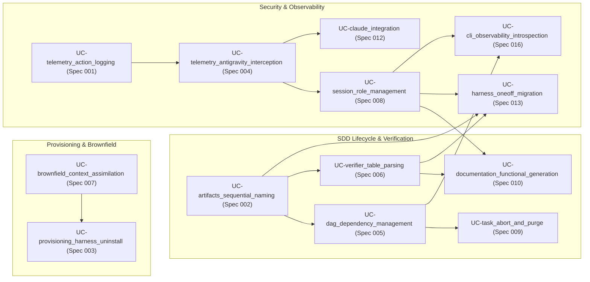

# Catalogo General de Casos de Uso — seb-harness

> **Documentacion Viva (Fase 6 — `seb-documentador`):** Este indice consolida los contratos funcionales en caja negra (*black-box*) derivados de las especificaciones aprobadas y verificadas deterministamente en `specs/`.

## Indice de Casos de Uso

| ID Caso de Uso | Dominio | Descripcion Funcional | Spec Originaria | Specs de Evolución | Estado |
| :--- | :--- | :--- | :--- | :--- | :--- |
| [UC-telemetry_action_logging](./UC-telemetry_action_logging.md) | Telemetria y Auditoria | Registro de duracion en milisegundos, cascada de tarea activa, calculo de costos USD por modelo, importacion idempotente de `usage.jsonl` y reporte consolidado. | `specs/001_registro_telemetria_acciones_spec.md` | - | Verificado |
| [UC-artifacts_sequential_naming](./UC-artifacts_sequential_naming.md) | Gobernanza de Artefactos | Homogeneizacion de prefijo secuencial `<NNN>_` en la triada SDD (`spec`, `plan`, `verificador`), reserva atomica con stub inicial en `spec-next`, sellado con clave canonica en `seb.lock`, resolucion flexible de tareas e identificadores internos unicos `<NNN>-<TIPO>-<NN>`. | `specs/002_prefijo_secuencial_artefactos_spec.md` | `specs/013_identificadores_unicos_requisitos_spec.md`, `specs/015_integridad_reserva_purga_spec.md` | Verificado |
| [UC-provisioning_harness_uninstall](./UC-provisioning_harness_uninstall.md) | Aprovisionamiento | Desinstalacion quirurgica e idempotente del arnes (`uninstall.sh`), reversion de Git hooks, restauracion de respaldos y modos `--self`, `--dry-run` y `--purge`. | `specs/003_desinstalacion_arnes_spec.md` | - | Verificado |
| [UC-telemetry_antigravity_interception](./UC-telemetry_antigravity_interception.md) | Telemetria e Intercepcion | Intercepcion de ciclo de vida (`PreToolUse`, `PostToolUse`, `Stop`), extraccion deduplicada de tokens y `cache_read_tokens` desde transcripcion y saneamiento de rutas. | `specs/004_captura_telemetria_antigravity_spec.md` | - | Verificado |
| [UC-dag_dependency_management](./UC-dag_dependency_management.md) | Grafo de Dependencias (DAG) | Declaracion `Depends-On`, validacion determinista de prerrequisitos y ciclos en `plan-lock`, sellado de `verified` y `commit_hash`, y protocolo de Scope Fork. | `specs/005_gestion_grafo_dependencias_spec.md` | - | Verificado |
| [UC-verifier_table_parsing](./UC-verifier_table_parsing.md) | Motor de Verificacion | Analizador sintactico contextual de tablas verificadoras con soporte de requisitos heterogeneos, aislamiento de pipes entre backticks y politica Anti-Silent-Drop, con `Check ID` `<NNN>-CHK-*` obligatorio y referencias de requisito validadas contra specs existentes. | `specs/006_parser_tabla_verificacion_spec.md` | `specs/013_identificadores_unicos_requisitos_spec.md` | Verificado |
| [UC-brownfield_context_assimilation](./UC-brownfield_context_assimilation.md) | Aprovisionamiento Brownfield | Deteccion de firma `seb-harness`, respaldo determinista `*.pre-seb.*`, asimilacion en `docs/constitution.md`, stubs de redireccion y restauracion al desinstalar. | `specs/007_migracion_contexto_brownfield_spec.md` | - | Verificado |
| [UC-session_role_management](./UC-session_role_management.md) | Seguridad y Menor Privilegio | Gestion determinista de rol activo (`seb role set/get/clear`), jerarquia de precedencia de 4 niveles y aislamiento de lecturas pasivas de habilidades de dominio, mas el rol one-off `migrador` con anti-escalada para agentes. | `specs/008_estado_sesion_determinista_spec.md` | `specs/013_identificadores_unicos_requisitos_spec.md` | Verificado |
| [UC-task_abort_and_purge](./UC-task_abort_and_purge.md) | Ciclo de Vida de Tareas | Cancelacion formal (`ABORTED` preservando telemetria) y purga atomica (`--purge`) acotada estrictamente a la identidad univoca de la tarea, con guardarrailes para tareas verificadas o con dependientes en el DAG. | `specs/009_aborto_tarea_spec.md` | `specs/015_integridad_reserva_purga_spec.md` | Verificado |
| [UC-documentation_functional_generation](./UC-documentation_functional_generation.md) | Documentacion Funcional | Integracion de la Fase 6 (`seb-documentador`), estructura estandar de casos de uso con diagramas Mermaid, guardarrailes de escritura, generacion de `AGENTS.md.patch.md` y procesamiento de listas multi-UC en `Afecta-UC:`, con citas obligatorias por identificador prefijado. | `specs/010_integracion_documentador_spec.md` | `specs/014_afecta_uc_multiple_spec.md`, `specs/013_identificadores_unicos_requisitos_spec.md` | Verificado |
| [UC-claude_integration](./UC-claude_integration.md) | Integracion Multi-Agente | Aprovisionamiento idempotente en `.claude/` (`install.sh`/`uninstall.sh`), selector `--format claude`, normalizacion de herramientas y contrato de salida para Claude Code y Claude Desktop. | `specs/012_soporte_claude_spec.md` | - | Verificado |
| [UC-harness_oneoff_migration](./UC-harness_oneoff_migration.md) | Ciclo de Vida del Arnes | Operaciones one-off de actualizacion identificadas por ID de spec, rol `migrador` activado solo por el humano y migracion auditada de identificadores heredados a `<NNN>-<TIPO>-<NN>` con resellado de `seb.lock`, rollback e idempotencia. | `specs/013_identificadores_unicos_requisitos_spec.md` | - | Verificado |
| [UC-cli_observability_introspection](./UC-cli_observability_introspection.md) | Observabilidad e Introspeccion | Vista unificada multi-fuente en `seb status` (`specs/`, `.seb/seb.lock` y SQLite opcional en lectura pura), deteccion de desfases, siguiente paso esperado, `--compact`/`--json`, ayuda bajo demanda `seb help`/`--help` y mapa de estados en `payload/`. | `specs/016_observabilidad_introspeccion_cli_spec.md` | - | Verificado |

## Mapa de Relaciones por Dominio

