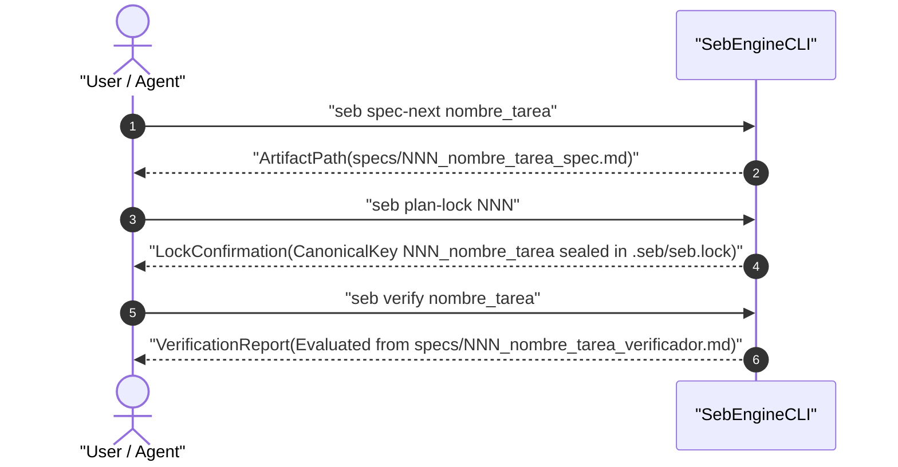
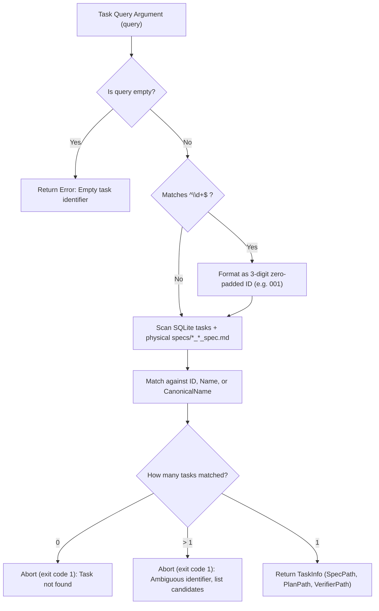

# UC-artifacts_sequential_naming: Homogeneizacion de Nomenclatura Secuencial y Resolucion de Tareas

> **Trazabilidad SDD:** Derivado de la spec `specs/002_prefijo_secuencial_artefactos_spec.md` (Requisitos: `RF-01`, `RF-02`, `RF-03`, `RF-04`, `RF-05`, `RF-06`, `RF-07`, `RF-08`, `RF-09`, `RF-10`, `RNF-01`, `RNF-02`).

## 1. Ficha de Intencion
- **ID:** UC-artifacts_sequential_naming
- **Actor Principal:** `Developer`, `AIAgent`
- **Disparador:** Invocacion de `seb spec-next <task_name>`, `seb plan-lock <query>`, `seb verify <query>` o `seb guard <role> write <target_path>`.
- **Precondiciones:**
  - Directorio `specs/` existente en la raiz del espacio de trabajo.
- **Invariantes de Negocio:**
  - La triada documental de toda tarea respeta el patron `specs/<NNN>_<tarea>_spec.md`, `specs/<NNN>_<tarea>_plan.md` y `specs/<NNN>_<tarea>_verificador.md` (`buildArtifactPath`).
  - El archivo `.seb/seb.lock` y el puntero `.seb/ACTIVE_TASK` almacenan exclusivamente la clave canonica `<NNN>_<tarea>` (`TaskInfo.CanonicalName`).
  - El resolvedor (`resolveTask`) acepta indistintamente el numero (`1` o `001`), el nombre simple (`<tarea>`) o la clave canonica (`<NNN>_<tarea>`), exigiendo unicidad estricta.

## 2. Diagrama de Interaccion del Sistema (SSD)

## 3. Arbol de Decisiones

## 4. Caminos Alternativos y Catalogo de Errores
| Error Code | Causa Raiz | Respuesta / Efecto |
| :--- | :--- | :--- |
| `EMPTY_TASK_QUERY` | Argumento de tarea vacio o compuesto solo por espacios | Aborto con mensaje de error en `stderr` y `exit code 1` |
| `TASK_NOT_FOUND` | El identificador no coincide con ninguna tarea en SQLite ni en `specs/` | Aborto con `[seb-harness ERROR] Error resolviendo tarea: tarea no encontrada` y `exit code 1` (`RF-07`) |
| `AMBIGUOUS_TASK_IDENTIFIER` | Nombre simple repetido en multiples secuencias (ej. `001_foo` y `004_foo`) | Aborto con listado de claves canonicas candidatas y `exit code 1` (`RF-07`, `CL-02`) |
| `GUARD_WRITE_DENIED` | Rol `implementador` intenta escribir en `specs/<NNN>_<tarea>_spec.md` o `_verificador.md` | Rechazo inmediato con `GUARDARRAIL DE MENOR PRIVILEGIO` y `exit code 1` (`RF-10`) |

## 5. Postcondiciones y Efectos Secundarios
- **Estado Persistido:** Creacion o actualizacion de entradas con clave `<NNN>_<tarea>` en `.seb/seb.lock`, escritura de `<NNN>_<tarea>` en `.seb/ACTIVE_TASK` y sincronizacion del registro en la tabla `tasks` de `.seb/seb-audit.db`.
- **Eventos Emitidos:** Ninguno.
- **Auditoria:** Registro de accion `spec-next`, `plan-lock`, `verify` o `guard-blocked:write` en `agent_actions`.
