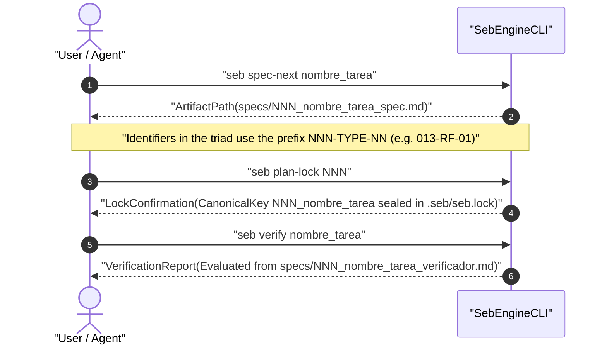
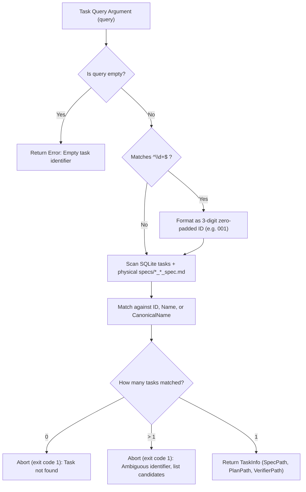

# UC-artifacts_sequential_naming: Homogeneizacion de Nomenclatura Secuencial y Resolucion de Tareas

> **Trazabilidad SDD:** Derivado de la spec `specs/002_prefijo_secuencial_artefactos_spec.md` (Requisitos: `002-RF-01`, `002-RF-02`, `002-RF-03`, `002-RF-04`, `002-RF-05`, `002-RF-06`, `002-RF-07`, `002-RF-08`, `002-RF-09`, `002-RF-10`, `002-RNF-01`, `002-RNF-02`).
> **Revision (Spec 013):** `specs/013_identificadores_unicos_requisitos_spec.md` (Requisitos: `013-RF-01` a `013-RF-06`, `013-RF-32`) extiende la nomenclatura secuencial a los identificadores internos de cada spec: todo elemento `HU`, `RF`, `RNF`, `CL` y `CHK` se identifica como `<NNN>-<TIPO>-<NN>`, unico en todo el repositorio.
> **Revision (Spec 015):** `specs/015_integridad_reserva_purga_spec.md` (Requisitos: `015-RF-01` a `015-RF-08`, `015-RF-11`, `015-RNF-01`, `015-RNF-02`) garantiza la reserva atomica en `seb spec-next [--dry-run] <nombre_tarea>` creando el archivo stub inicial en disco, rechazando colisiones de ID y acotando la idempotencia a stubs sin redactar.

## 1. Ficha de Intencion
- **ID:** UC-artifacts_sequential_naming
- **Actor Principal:** `Developer`, `AIAgent`
- **Disparador:** Invocacion de `seb spec-next [--dry-run] <task_name>`, `seb plan-lock <query>`, `seb verify <query>` o `seb guard <role> write <target_path>`.
- **Precondiciones:**
  - Directorio `specs/` existente en la raiz del espacio de trabajo.
- **Invariantes de Negocio:**
  - `seb spec-next <task_name>` calcula el siguiente ID tomando el maximo entre `specs/` y `tasks` en SQLite (`015-RF-01`, `015-RNF-01`), crea de forma atomica el archivo stub inicial `specs/<NNN>_<task_name>_spec.md` (`015-RF-02`) y revierte la reserva en SQLite si falla la escritura en disco (`015-RF-07`, `015-RNF-02`).
  - `seb spec-next <task_name>` es idempotente solo cuando la spec existente conserva el contenido exacto del stub inicial (`015-RF-04`) y rechaza reutilizar el nombre si ya fue redactada (`015-RF-05`); con `--dry-run` devuelve la ruta propuesta sin efectos secundarios (`015-RF-06`).
  - Las instrucciones de `seb-especificador` reflejan que `seb spec-next` crea el archivo stub inicial en disco para ser completado en Fase 4 (`015-RF-11`).
  - La triada documental de toda tarea respeta el patron `specs/<NNN>_<tarea>_spec.md`, `specs/<NNN>_<tarea>_plan.md` y `specs/<NNN>_<tarea>_verificador.md` (`buildArtifactPath`).
  - El archivo `.seb/seb.lock` y el puntero `.seb/ACTIVE_TASK` almacenan exclusivamente la clave canonica `<NNN>_<tarea>` (`TaskInfo.CanonicalName`).
  - El resolvedor (`resolveTask`) acepta indistintamente el numero (`1` o `001`), el nombre simple (`<tarea>`) o la clave canonica (`<NNN>_<tarea>`), exigiendo unicidad estricta.
  - Todo identificador declarado dentro de la triada de una tarea lleva el prefijo de su spec: `<NNN>-HU-<NN>`, `<NNN>-RF-<NN>`, `<NNN>-RNF-<NN>`, `<NNN>-CL-<NN>` y `<NNN>-CHK-<sufijo>` (ej. `013-RF-05`). Las plantillas distribuidas por `seb-especificador` y `seb-planificador` usan el marcador `<NNN>`, que se sustituye por el ID devuelto por `seb spec-next` (`013-RF-01` a `013-RF-04`).
  - `seb-clarificador` impide aprobar una spec con identificadores declarados sin prefijo, con prefijo distinto a su `Tarea ID` o duplicados (`013-RF-05`, `013-RF-06`).
  - Las referencias a requisitos fuera de su spec (comentarios, tests, `MEMORY.md`, commits, casos de uso) usan el identificador prefijado solo como texto, nunca como parte de identificadores de codigo (`013-RF-32`).

## 2. Diagrama de Interaccion del Sistema (SSD)

## 3. Arbol de Decisiones

## 4. Caminos Alternativos y Catalogo de Errores
| Error Code | Causa Raiz | Respuesta / Efecto |
| :--- | :--- | :--- |
| `EMPTY_TASK_QUERY` | Argumento de tarea vacio o compuesto solo por espacios | Aborto con mensaje de error en `stderr` y `exit code 1` |
| `TASK_NOT_FOUND` | El identificador no coincide con ninguna tarea en SQLite ni en `specs/` | Aborto con `[seb-harness ERROR] Error resolviendo tarea: tarea no encontrada` y `exit code 1` (`002-RF-07`) |
| `AMBIGUOUS_TASK_IDENTIFIER` | Nombre simple repetido en multiples secuencias (ej. `001_foo` y `004_foo`) | Aborto con listado de claves canonicas candidatas y `exit code 1` (`002-RF-07`, `002-CL-02`) |
| `GUARD_WRITE_DENIED` | Rol `implementador` intenta escribir en `specs/<NNN>_<tarea>_spec.md` o `_verificador.md` | Rechazo inmediato con `GUARDARRAIL DE MENOR PRIVILEGIO` y `exit code 1` (`002-RF-10`) |
| `UNPREFIXED_IDENTIFIER` | Spec en clarificacion con identificadores sin prefijo, con prefijo distinto a su `Tarea ID` o duplicados | `seb-clarificador` registra la observacion y bloquea la transicion a `APROBADA` (`013-RF-06`) |
| `LEGACY_CHECK_ID` | Verificador con filas `CHK-NN` sin prefijo de spec | `seb plan-lock` / `seb verify` abortan con `exit code 1` e indican el comando de migracion (ver `UC-verifier_table_parsing` y `UC-harness_oneoff_migration`) |
| `SPEC_ID_COLLISION` | Intento de reservar o sincronizar un ID ya asignado a otro nombre de tarea | Rechazo explicito en `stderr` con `exit code 1` preservando disco y SQLite (`015-RF-03`) |
| `EDITED_SPEC_NAME_EXISTS` | Invocacion de `seb spec-next` con un nombre cuya spec ya fue editada mas alla del stub | Rechazo explicito en `stderr` con `exit code 1` sin modificar el archivo (`015-RF-05`) |
| `INVALID_TASK_NAME` | Nombre vacio, invalido tras saneamiento o con traversal (`..`, `/`, `\`) | Rechazo inmediato con `exit code 1` sin efectos secundarios (`015-RF-08`) |
| `STUB_DISK_WRITE_ERROR` | Fallo de permisos o I/O al crear el archivo stub en `specs/` | Rollback completo de la reserva en SQLite y `exit code 1` (`015-RF-07`, `015-CL-04`) |

## 5. Postcondiciones y Efectos Secundarios
- **Estado Persistido:** Creacion o actualizacion de entradas con clave `<NNN>_<tarea>` en `.seb/seb.lock`, escritura de `<NNN>_<tarea>` en `.seb/ACTIVE_TASK` y sincronizacion del registro en la tabla `tasks` de `.seb/seb-audit.db`.
- **Eventos Emitidos:** Ninguno.
- **Auditoria:** Registro de accion `spec-next`, `plan-lock`, `verify` o `guard-blocked:write` en `agent_actions`.
