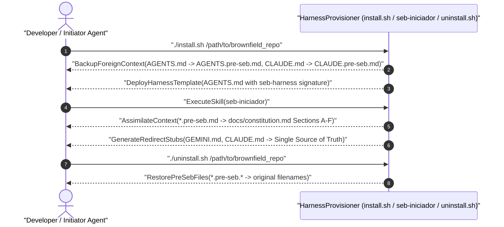
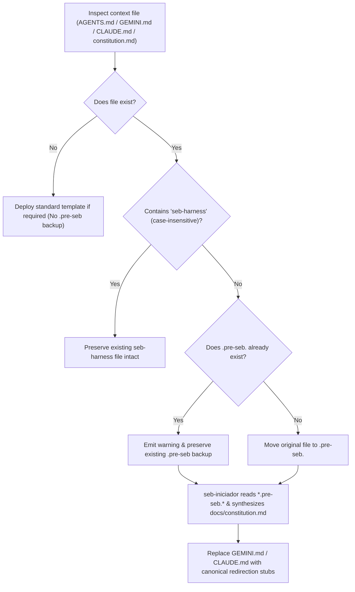

# UC-brownfield_context_assimilation: Asimilacion de Contexto Preexistente y Reversibilidad en Proyectos Brownfield

> **Trazabilidad SDD:** Derivado de la spec `specs/007_migracion_contexto_brownfield_spec.md` (Requisitos: `007-RF-01` a `007-RF-09`, `007-RNF-01`, `007-RNF-02`).
> **Revision (Spec 017):** `specs/017_separacion_protocolo_agents_spec.md` (Requisitos: `017-RF-01` a `017-RF-08`, `017-RF-11`, `017-RF-12`, `017-RNF-01` a `017-RNF-03`, `017-CL-01` a `017-CL-03`) separa el protocolo SDD completo en `.agents/SEB-HARNESS.md`, transforma `AGENTS.md` en un enrutador liviano con bloque gestionado (`<!-- BEGIN/END seb-harness:managed -->`), respalda archivos `AGENTS.md` legados en `AGENTS.legacy-seb.md` y exige aborto ante marcadores malformados.

## 1. Ficha de Intencion
- **ID:** UC-brownfield_context_assimilation
- **Actor Principal:** `Developer`, `AIAgent` (`seb-iniciador`)
- **Disparador:** Ejecucion de `./install.sh /path/to/target` seguida de la fase de inicializacion mediante el skill `seb-iniciador` (y reversion eventual mediante `./uninstall.sh /path/to/target`).
- **Precondiciones:**
  - Repositorio destino existente que puede contener archivos de contexto preexistentes (`AGENTS.md`, `GEMINI.md`, `CLAUDE.md`, `docs/constitution.md`).
- **Invariantes de Negocio:**
  - Un archivo de contexto se reconoce como propio del arnes si y solo si contiene la firma canonica `seb-harness` de forma insensible a mayusculas y minusculas (`has_seb_signature`).
  - Todo archivo de contexto ajeno (sin firma `seb-harness`) es respaldado bajo la nomenclatura `<nombre>.pre-seb.<ext>` antes de ser sustituido (`007-RF-01`, `007-RF-02`, `007-RF-04`, `017-RF-05`).
  - Si un respaldo `<nombre>.pre-seb.<ext>` o `AGENTS.legacy-seb.md` ya existe, nunca se sobrescribe (`007-RF-07`, `017-RF-06`).
  - El protocolo SDD completo se distribuye y sobrescribe siempre en `.agents/SEB-HARNESS.md`, mientras `AGENTS.md` actua como enrutador liviano (bloque gestionado de maximo 30 lineas) y `.agents/rules/00-seb-harness.md` se limita a invariantes universales (maximo 35 lineas) (`017-RF-01`, `017-RF-02`, `017-RF-03`, `017-RF-08`, `017-RNF-02`).
  - Cuando `AGENTS.md` contiene un par unico y bien formado de marcadores `<!-- BEGIN seb-harness:managed -->` y `<!-- END seb-harness:managed -->`, `install.sh` (incluyendo modo `--self`) sustituye literalmente solo dicho bloque conservando byte a byte el contenido propio del proyecto (`017-RF-04`, `017-RF-11`, `017-RNF-01`, `017-CL-01`).
  - Si `AGENTS.md` tiene firma `seb-harness` en formato legado (sin marcadores), `install.sh` lo respalda como `AGENTS.legacy-seb.md` e instala el enrutador con marcadores (`017-RF-06`).
  - Los stubs `GEMINI.md` y `CLAUDE.md` generados por `seb-iniciador` apuntan a `AGENTS.md` como punto unico de enrutamiento sin acoplarse directamente a `.agents/SEB-HARNESS.md` (`017-RF-12`).

## 2. Diagrama de Interaccion del Sistema (SSD)

## 3. Arbol de Decisiones

## 4. Caminos Alternativos y Catalogo de Errores
| Error Code | Causa Raiz | Respuesta / Efecto |
| :--- | :--- | :--- |
| `BACKUP_ALREADY_EXISTS` | Ya existe un archivo `<nombre>.pre-seb.<ext>` en una reinstalacion | Emision de advertencia en `stderr` conservando intacto el respaldo original (`007-RF-07`) |
| `CONTRADICTORY_LEGACY_DIRECTIVE` | El archivo `.pre-seb.md` indica omitir pruebas o especificaciones | Descarte de la directiva incompatible con la gobernanza SDD y registro en `MEMORY.md` (`007-CL-03`) |
| `EMPTY_FOREIGN_CONTEXT_FILE` | El archivo ajeno tiene `0` bytes o solo espacios en blanco | Respaldo normal a `<nombre>.pre-seb.<ext>` sin arrojar error (`007-CL-01`) |
| `MALFORMED_MANAGED_MARKERS` | `AGENTS.md` contiene marcadores `BEGIN`/`END` incompletos, invertidos o duplicados | Preservacion intacta de `AGENTS.md`, mensaje diagnostico en `stderr` y aborto con `exit code 1` (`017-RF-07`, `017-CL-02`) |
| `LEGACY_SEB_AGENTS_FORMAT` | `AGENTS.md` posee firma `seb-harness` pero carece de marcadores de bloque gestionado | Respaldo automatico en `AGENTS.legacy-seb.md` (sin sobrescribir respaldo previo) e instalacion del enrutador gestionado (`017-RF-06`) |

## 5. Postcondiciones y Efectos Secundarios
- **Estado Persistido:** Archivos originales preservados en `*.pre-seb.*`, reglas de dominio y stack consolidadas en `docs/constitution.md`, y archivos `GEMINI.md` / `CLAUDE.md` convertidos en stubs con firma `seb-harness` apuntando a `docs/constitution.md` y `AGENTS.md`. Al ejecutar `uninstall.sh`, restauracion automatica de `*.pre-seb.*` a sus nombres originales.
- **Eventos Emitidos:** Mensajes informativos `info` y advertencias `warn` en salida de terminal.
- **Auditoria:** Registro de discrepancias o restricciones heredadas en `MEMORY.md`.
