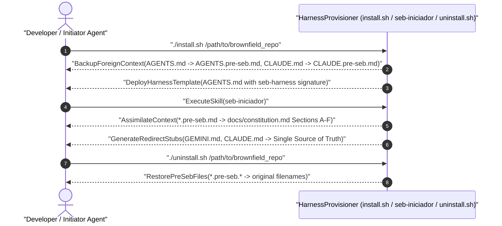
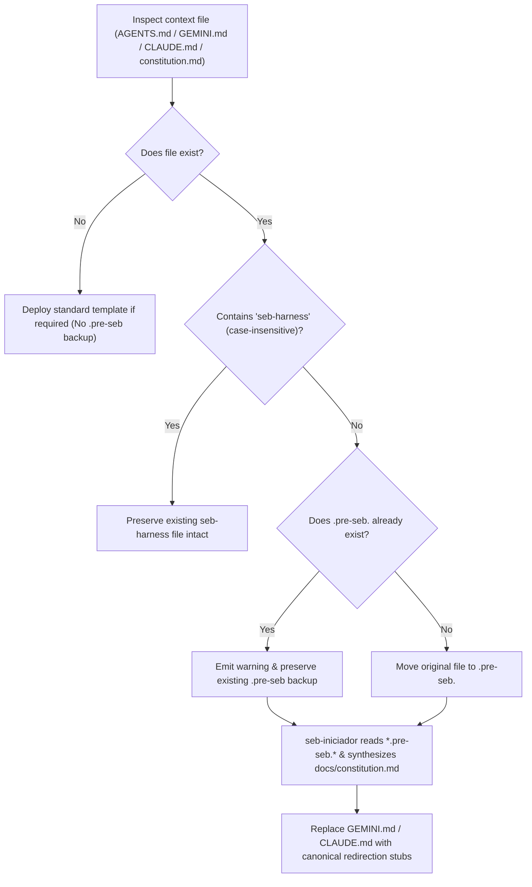

# UC-brownfield_context_assimilation: Asimilacion de Contexto Preexistente y Reversibilidad en Proyectos Brownfield

> **Trazabilidad SDD:** Derivado de la spec `specs/007_migracion_contexto_brownfield_spec.md` (Requisitos: `007-RF-01` a `007-RF-09`, `007-RNF-01`, `007-RNF-02`).

## 1. Ficha de Intencion
- **ID:** UC-brownfield_context_assimilation
- **Actor Principal:** `Developer`, `AIAgent` (`seb-iniciador`)
- **Disparador:** Ejecucion de `./install.sh /path/to/target` seguida de la fase de inicializacion mediante el skill `seb-iniciador` (y reversion eventual mediante `./uninstall.sh /path/to/target`).
- **Precondiciones:**
  - Repositorio destino existente que puede contener archivos de contexto preexistentes (`AGENTS.md`, `GEMINI.md`, `CLAUDE.md`, `docs/constitution.md`).
- **Invariantes de Negocio:**
  - Un archivo de contexto se reconoce como propio del arnes si y solo si contiene la firma canonica `seb-harness` de forma insensible a mayusculas y minusculas (`has_seb_signature`).
  - Todo archivo de contexto ajeno (sin firma `seb-harness`) es respaldado bajo la nomenclatura `<nombre>.pre-seb.<ext>` antes de ser sustituido (`007-RF-01`, `007-RF-02`, `007-RF-04`).
  - Si un respaldo `<nombre>.pre-seb.<ext>` ya existe, nunca se sobrescribe (`007-RF-07`).

## 2. Diagrama de Interaccion del Sistema (SSD)

## 3. Arbol de Decisiones

## 4. Caminos Alternativos y Catalogo de Errores
| Error Code | Causa Raiz | Respuesta / Efecto |
| :--- | :--- | :--- |
| `BACKUP_ALREADY_EXISTS` | Ya existe un archivo `<nombre>.pre-seb.<ext>` en una reinstalacion | Emision de advertencia en `stderr` conservando intacto el respaldo original (`007-RF-07`) |
| `CONTRADICTORY_LEGACY_DIRECTIVE` | El archivo `.pre-seb.md` indica omitir pruebas o especificaciones | Descarte de la directiva incompatible con la gobernanza SDD y registro en `MEMORY.md` (`007-CL-03`) |
| `EMPTY_FOREIGN_CONTEXT_FILE` | El archivo ajeno tiene `0` bytes o solo espacios en blanco | Respaldo normal a `<nombre>.pre-seb.<ext>` sin arrojar error (`007-CL-01`) |

## 5. Postcondiciones y Efectos Secundarios
- **Estado Persistido:** Archivos originales preservados en `*.pre-seb.*`, reglas de dominio y stack consolidadas en `docs/constitution.md`, y archivos `GEMINI.md` / `CLAUDE.md` convertidos en stubs con firma `seb-harness` apuntando a `docs/constitution.md` y `AGENTS.md`. Al ejecutar `uninstall.sh`, restauracion automatica de `*.pre-seb.*` a sus nombres originales.
- **Eventos Emitidos:** Mensajes informativos `info` y advertencias `warn` en salida de terminal.
- **Auditoria:** Registro de discrepancias o restricciones heredadas en `MEMORY.md`.
