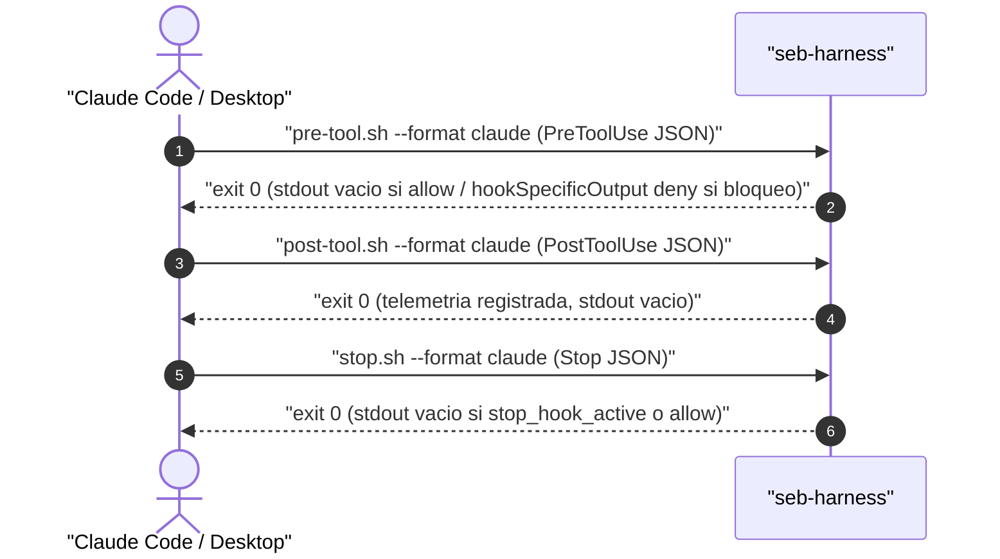
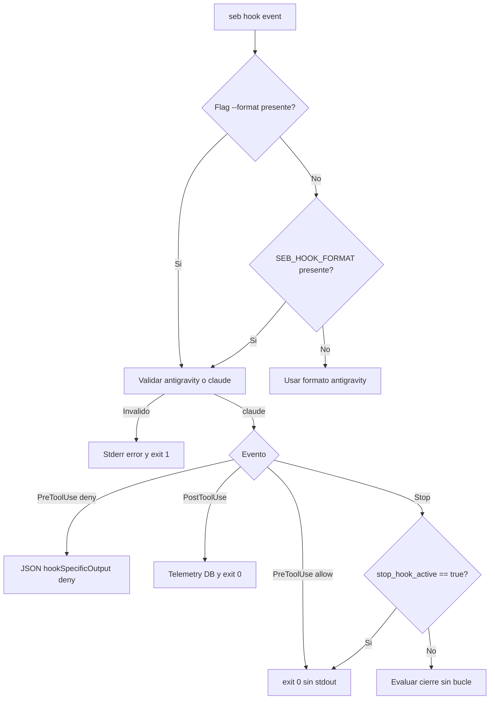

# UC-claude_integration: Integracion y Formato de Hooks para Claude (Claude Code y Claude Desktop)

> **Trazabilidad SDD:** Derivado de la spec `specs/012_soporte_claude_spec.md` (Requisitos: `RF-01` a `RF-19`, `RNF-01` a `RNF-04`, `CL-01` a `CL-06`).

## 1. Ficha de Intencion
- **ID:** UC-claude_integration
- **Actor Principal:** Operador / Cliente Claude (`Claude Code`, `Claude Desktop`)
- **Disparador:** Ejecucion de `install.sh`, `uninstall.sh` o invocacion de `seb hook <pre-tool|post-tool|stop> --format claude`
- **Precondiciones:**
  - El repositorio destino cuenta con `.agents/` y el motor `.seb/bin/seb` (o modo fallback en scripts `.agents/hooks/*.sh`).
  - Para operaciones sobre `.claude/settings.json`, el archivo (si existe) debe contener un objeto JSON sintacticamente valido.
- **Invariantes de Negocio:**
  - La instalacion crea `.claude/{hooks,rules,skills}` -> `../.agents/*` y fusiona `.claude/settings.json` unicamente cuando no existen previamente, sin sobreescribir configuraciones del usuario.
  - La precedencia de formato es estricta: `--format` > `SEB_HOOK_FORMAT` > `"antigravity"`.
  - El formato por defecto `antigravity` permanece identico byte a byte respecto al comportamiento historico.
  - En `Stop` con `stop_hook_active: true`, el sistema nunca emite `decision: "block"`.

## 2. Diagrama de Interaccion del Sistema (SSD)

## 3. Arbol de Decisiones

## 4. Caminos Alternativos y Catalogo de Errores

| Error Code | Causa Raiz | Respuesta / Efecto |
| :--- | :--- | :--- |
| `UNSUPPORTED_FORMAT` | Valor distinto de `antigravity` o `claude` en `--format` o `SEB_HOOK_FORMAT` | Mensaje `[ERROR]` en `stderr` y salida con codigo `1` |
| `MALFORMED_CLAUDE_JSON` | Payload vacio o JSON invalido en `stdin` bajo formato `claude` | Finalizacion segura con codigo `0` y sin salida bloqueante |
| `MISSING_SEB_BIN` | Ausencia de `.seb/bin/seb` al invocar `.agents/hooks/*.sh --format claude` | Fallback seguro con codigo `0` y `stdout` vacio |
| `CORRUPT_SETTINGS_JSON` | `.claude/settings.json` preexistente con JSON invalido o no-objeto en `install.sh`/`uninstall.sh` | Aborto inmediato con codigo distinto de `0` sin alterar el archivo |
| `GUARDRAIL_DENY` | Violacion de menor privilegio, acceso a archivo sensible o comando peligroso en `PreToolUse` | JSON `hookSpecificOutput` con `permissionDecision: "deny"` y `permissionDecisionReason` |

## 5. Postcondiciones y Efectos Secundarios

- **Estado Persistido:** En formato `claude`, `PostToolUse` y `Stop` registran acciones y metricas en `.seb/seb-audit.db` (`agent_actions`) con `agent = "claude"` cuando no se especifica modelo. En disco, `install.sh` deja enlazado `.claude/{hooks,rules,skills}` y configurado `.claude/settings.json`; `uninstall.sh` revierte unicamente los artefactos propios del arnes.
- **Eventos Emitidos:** Decisiones estructuradas `PreToolUse` (`hookSpecificOutput`), `PostToolUse` (`additionalContext` opcional) y `Stop` (`decision: "block"` solo si `stop_hook_active` es `false`).
- **Auditoria:** Registro de bloqueos de menor privilegio (`guard-blocked:write`) y telemetria de ejecucion en `.seb/seb-audit.db`.
