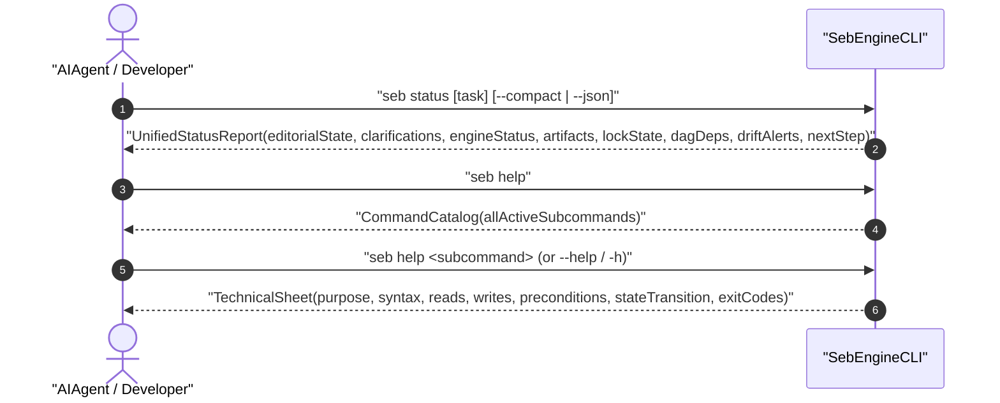
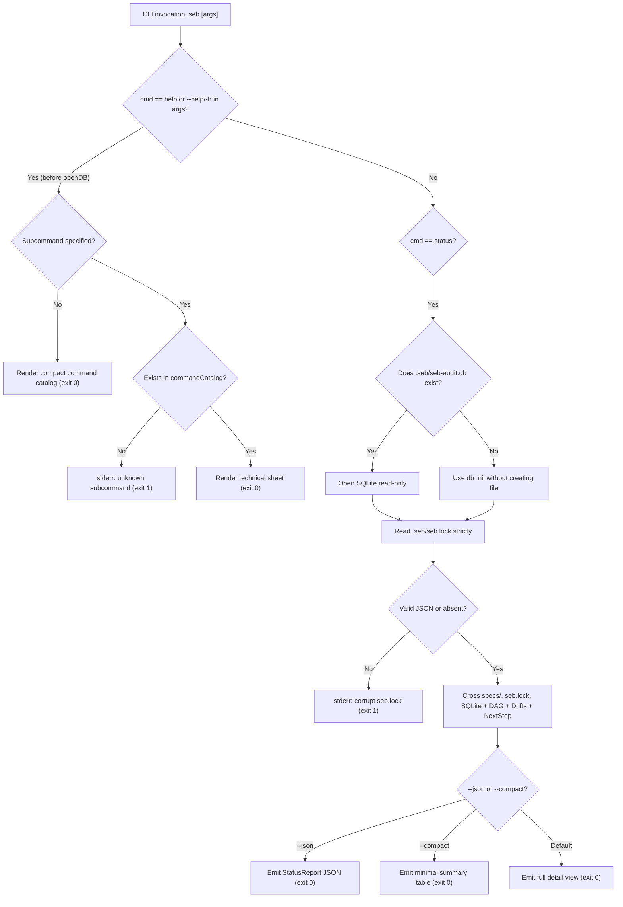

# UC-cli_observability_introspection: Observabilidad Unificada e Introspeccion Bajo Demanda del CLI

> **Trazabilidad SDD:** Derivado de la spec `specs/016_observabilidad_introspeccion_cli_spec.md` (Requisitos: `016-RF-01` a `016-RF-17`, `016-RNF-01` a `016-RNF-03`, `016-CL-01` a `016-CL-05`).
> **Revision (Spec 018):** `specs/018_flujo_rapido_spec.md` (Requisitos: `018-RF-16`, `018-CL-02`, `018-CL-06`) extiende `seb status` (vista completa, `--compact` y `--json`) para distinguir explicitamente `FAST` vs `SDD`, reportar `has_unified_plan_verifier` en clones limpios o con DB, rechazar con codigo `1` artefactos mixtos ambiguos y documentar el flujo `FAST` en `seb help`.

## 1. Ficha de Intencion
- **ID:** UC-cli_observability_introspection
- **Actor Principal:** `AIAgent` (cualquier rol SDD), `Developer`
- **Disparador:** Ejecucion de `seb status [<task>] [--compact] [--json]`, `seb help [<subcommand>]`, o `seb <subcommand> --help|-h`.
- **Precondiciones:**
  - Binario `.seb/bin/seb` disponible en el proyecto consumidor.
  - Puede ejecutarse tanto en entornos inicializados como en clones limpios sin `.seb/seb-audit.db` ni `.seb/seb.lock` (`016-RF-04`, `016-CL-01`).
- **Invariantes de Negocio:**
  - Todas las operaciones de `seb status`, `seb help` y `--help`/`-h` son estrictamente de solo lectura y nunca crean ni modifican `specs/`, `.seb/seb.lock`, `.seb/ACTIVE_TASK` ni `.seb/seb-audit.db` (`016-RF-04`, `016-RNF-02`).
  - Todos los roles SDD (`seb-iniciador`, `seb-especificador`, `seb-clarificador`, `seb-planificador`, `implementador`, `seb-verificador`, `seb-documentador`) tienen permiso explicito en `seb guard` y `PreToolUse` para ejecutar consultas de estado y ayuda (`016-RF-17`).
  - La ayuda detallada por subcomando se entrega bajo demanda (`seb help <subcommand>` o `--help`/`-h`) manteniendo compacto el catalogo raiz (`016-RNF-03`).

## 2. Diagrama de Interaccion del Sistema (SSD)

## 3. Arbol de Decisiones

## 4. Caminos Alternativos y Catalogo de Errores
| Error Code | Causa Raiz | Respuesta / Efecto |
| :--- | :--- | :--- |
| `TASK_NOT_FOUND` | El filtro `<task>` en `seb status <task>` no coincide con ninguna tarea en disco, lock ni SQLite | Mensaje por `stderr` y `exit code 1` (`016-RF-07`) |
| `AMBIGUOUS_TASK` | El filtro `<task>` coincide con multiples tareas | Mensaje por `stderr` listando candidatos y `exit code 1` (`016-RF-07`) |
| `CORRUPT_LOCK_FILE` | `.seb/seb.lock` existe pero contiene JSON invalido o ilegible | Aborto inmediato con error por `stderr` y `exit code 1` (`016-CL-05`) |
| `UNKNOWN_SUBCOMMAND` | `seb help <subcommand>` o `<subcommand> --help` referencia un subcomando inexistente | Mensaje por `stderr` y `exit code 1` (`016-RF-12`) |
| `EMPTY_SPEC_STATE` | Un archivo `*_spec.md` carece de cabecera `Estado:` o tiene un valor no reconocido | Reporte de estado editorial `DESCONOCIDO` con alerta sin abortar el resto (`016-CL-02`) |

## 5. Postcondiciones y Efectos Secundarios
- **Estado Persistido:** Ninguno (`016-RNF-02`). Ni `.seb/seb-audit.db`, ni `.seb/seb.lock`, ni `.seb/ACTIVE_TASK`, ni `specs/` sufren escrituras.
- **Eventos Emitidos:** Salida determinista por `stdout` (vista completa, tabla `--compact`, JSON `--json`, catalogo `seb help` o ficha tecnica por subcomando) o errores por `stderr`.
- **Auditoria:** Operacion pasiva sin escritura en `agent_actions` ni creacion de base de datos local.
