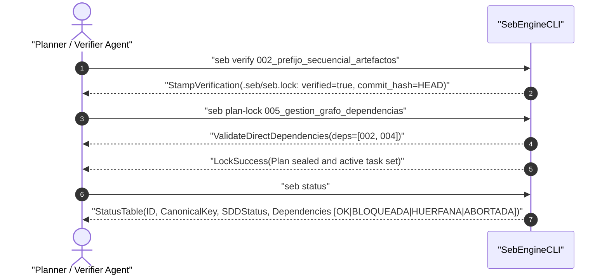
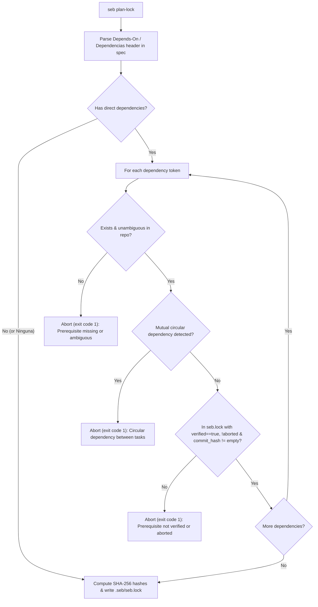
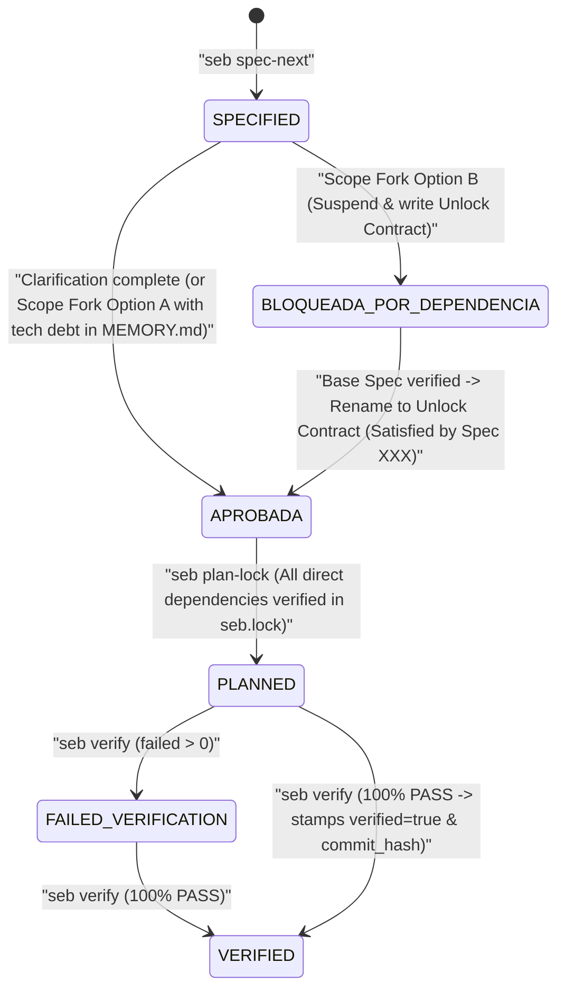

# UC-dag_dependency_management: Gestion de Grafo de Dependencias (DAG), Guardarrail de Planificacion y Bifurcacion de Alcance

> **Trazabilidad SDD:** Derivado de la spec `specs/005_gestion_grafo_dependencias_spec.md` (Requisitos: `RF-01` a `RF-16`, `RNF-01`, `RNF-02`, `RNF-03`).

## 1. Ficha de Intencion
- **ID:** UC-dag_dependency_management
- **Actor Principal:** `Developer`, `AIAgent` (`seb-clarificador`, `seb-planificador`, `seb-verificador`)
- **Disparador:** Ejecucion de `seb plan-lock <task>`, `seb verify <task>`, `seb status` o auditoria interactiva de brechas de capacidad durante `seb-clarificador`.
- **Precondiciones:**
  - Especificacion en `specs/<NNN>_<tarea>_spec.md` con cabecera opcional `Dependencias:` o `Depends-On:`.
  - Archivo `.seb/seb.lock` accesible en el repositorio.
- **Invariantes de Negocio:**
  - Una tarea solo puede sellar su plan (`plan-lock`) si el 100% de sus dependencias directas declaradas existen, no forman referencias circulares mutuas y figuran en `.seb/seb.lock` con `verified: true`, `aborted: false` y `commit_hash` no vacio (`RF-05`, `RF-06`, `RF-07`).
  - Toda especificacion en estado `BLOQUEADA_POR_DEPENDENCIA` o con seccion `## Contrato de Desbloqueo Requerido` sin resolver tiene prohibido transicionar a `APROBADA` (`RF-13`).

## 2. Diagrama de Interaccion del Sistema (SSD)

## 3. Arbol de Decisiones y Ciclo de Vida de Estados

## 4. Caminos Alternativos y Catalogo de Errores
| Error Code | Causa Raiz | Respuesta / Efecto |
| :--- | :--- | :--- |
| `PREREQUISITE_NOT_FOUND` | La dependencia declarada en `Depends-On:` no existe en `specs/` o es ambigua | Aborto de `plan-lock` con `[seb-harness ERROR] BLOQUEO SDD: la tarea prerrequisito '...' no existe` y `exit code 1` (`CL-01`, `CL-02`) |
| `CIRCULAR_DEPENDENCY_DETECTED` | La tarea A depende de B y la tarea B depende de A (o de si misma) | Aborto de `plan-lock` reportando la referencia circular mutua y `exit code 1` (`RF-07`, `CL-04`) |
| `PREREQUISITE_UNVERIFIED` | La tarea base existe pero no tiene `verified: true` y `commit_hash` en `.seb/seb.lock` | Aborto de `plan-lock` con mensaje de bloqueo SDD y `exit code 1` (`RF-06`, `CL-03`) |
| `PREREQUISITE_ABORTED` | La tarea prerrequisito figura con `aborted: true` en `.seb/seb.lock` | Aborto de `plan-lock` indicando que la dependencia fue abortada (`exit code 1`) |

## 5. Postcondiciones y Efectos Secundarios
- **Estado Persistido:** Actualizacion de `TaskLock` en `.seb/seb.lock` con `verified: true` y `commit_hash` al aprobar `seb verify`. En caso de Scope Fork durante clarificacion, actualizacion de la spec con `Estado: BLOQUEADA_POR_DEPENDENCIA` y `## Contrato de Desbloqueo Requerido`, o registro de deuda tecnica en `MEMORY.md` via `seb memory-add`.
- **Eventos Emitidos:** Sugerencia en consola del comando `.seb/bin/seb spec-next <base_task>` cuando se suspende una spec por dependencia.
- **Auditoria:** Registro del resultado de `plan-lock` y `verify` en `agent_actions` de `.seb/seb-audit.db`.
