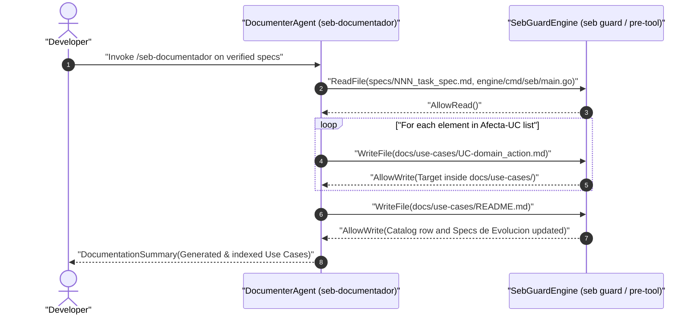
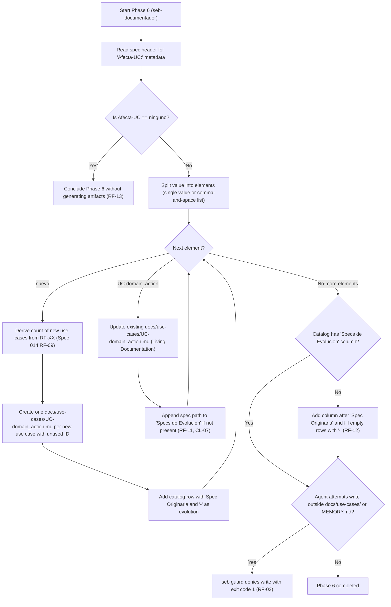

# UC-documentation_functional_generation: Generacion de Documentacion Funcional de Casos de Uso y Guardarrail de Fase 6

> **Trazabilidad SDD:** Derivado de la spec `specs/010_integracion_documentador_spec.md` (Requisitos: `RF-01` a `RF-13`, `RNF-01`, `RNF-02`, `RNF-03`).
> **Revision (Spec 014):** `specs/014_afecta_uc_multiple_spec.md` (Requisitos: `RF-08` a `RF-12`, `CL-07`) incorpora el procesamiento de listas en `Afecta-UC:`, la resolucion de `nuevo` en uno o mas casos de uso y la columna "Specs de Evolución" del catalogo.

## 1. Ficha de Intencion
- **ID:** UC-documentation_functional_generation
- **Actor Principal:** `Developer`, `AIAgent` (Rol `seb-documentador`)
- **Disparador:** Ejecucion del skill `seb-documentador` tras obtener `VEREDICTO: APROBADO` en la Fase 5 (`seb-verificador`), o aprovisionamiento del skill mediante `./install.sh`.
- **Precondiciones:**
  - La tarea objetivo cuenta con verificacion determinista aprobada (`verified: true` en `.seb/seb.lock`).
  - El rol activo de sesion corresponde a `seb-documentador` (vía `SEB_SKILL="seb-documentador"`, `seb role set seb-documentador` o inferencia de lectura de `.agents/skills/seb-documentador/SKILL.md`).
- **Invariantes de Negocio:**
  - Bajo el rol `seb-documentador`, el guardarraíl de menor privilegio (`checkPermission`) autoriza escrituras exclusivamente sobre `docs/use-cases/*`, `docs/use-cases/README.md` y `MEMORY.md`, bloqueando cualquier modificacion en codigo fuente, tests, `docs/constitution.md` o `specs/*` (`RF-02`, `RF-03`).
  - Todo artefacto generado en `docs/use-cases/UC-<dominio>_<accion>.md` carece por completo de emojis, utiliza `autonumber` en diagramas `sequenceDiagram`, emplea identificadores tecnicos en ingles y redacta las explicaciones en espanol (`RF-04`, `RF-05`, `RF-06`).
  - Si un proyecto existente posee `AGENTS.md` con firma `seb-harness` pero sin mencion a `seb-documentador`, `install.sh` conserva `AGENTS.md` y genera `AGENTS.md.patch.md` (`RF-11`, `CL-03`).
  - Cuando `Afecta-UC:` declara una lista (elementos entre backticks separados por coma y espacio, sin orden significativo), se actualiza cada caso de uso `UC-<dominio>_<accion>` declarado (Spec 014 `RF-08`).
  - Un elemento `nuevo` (valor simple o dentro de una lista, como maximo una vez) se resuelve en uno o mas casos de uso nuevos cuya cantidad se deriva de los `RF-XX`, cada uno con un identificador inexistente en el catalogo (Spec 014 `RF-09`).
  - El catalogo `docs/use-cases/README.md` mantiene la columna "Specs de Evolución" inmediatamente despues de "Spec Originaria"; al evolucionar un caso de uso se agrega la ruta de la spec sin modificar su "Spec Originaria" y sin duplicar rutas (Spec 014 `RF-10`, `RF-11`, `CL-07`).

## 2. Diagrama de Interaccion del Sistema (SSD)

## 3. Arbol de Decisiones

## 4. Caminos Alternativos y Catalogo de Errores
| Error Code | Causa Raiz | Respuesta / Efecto |
| :--- | :--- | :--- |
| `GUARD_DOCUMENTER_WRITE_DENIED` | El rol `seb-documentador` intenta escribir en codigo fuente, tests, `docs/constitution.md` o `specs/*` | Rechazo inmediato con `GUARDARRAIL DE MENOR PRIVILEGIO: El rol 'seb-documentador' NO tiene permiso` y `exit code 1` (`RF-03`) |
| `NO_UC_IMPACT_SKIP` | La especificacion declara `Afecta-UC: ninguno` | Finalizacion limpia de la Fase 6 sin crear archivos en `docs/use-cases/` (`RF-13`) |
| `MISSING_AFECTA_UC_METADATA` | Especificacion redactada sin el campo `Afecta-UC:` | Asuncion por defecto de creacion de nuevo caso de uso bajo `UC-<dominio>_<accion>.md` (`CL-04`) |
| `LEGACY_AGENTS_MD_DETECTED` | `install.sh` detecta `AGENTS.md` con firma `seb-harness` pero sin referencia a `seb-documentador` | Creacion de `AGENTS.md.patch.md` y advertencia en consola sin sobrescribir `AGENTS.md` (`RF-11`) |
| `CATALOG_MISSING_EVOLUTION_COLUMN` | `docs/use-cases/README.md` existe sin la columna "Specs de Evolución" | Se agrega la columna tras "Spec Originaria" y se completan con `-` las filas sin evoluciones (Spec 014 `RF-12`) |
| `EVOLUTION_ALREADY_REGISTERED` | La ruta de la spec ya figura en "Specs de Evolución" del caso de uso | No se duplica la ruta; la fila queda sin cambios en esa columna (Spec 014 `CL-07`) |

## 5. Postcondiciones y Efectos Secundarios
- **Estado Persistido:** Creacion o actualizacion de artefactos `docs/use-cases/UC-<dominio>_<accion>.md` (uno por cada elemento de `Afecta-UC:`, y uno o mas por `nuevo`) y sincronizacion del catalogo indice `docs/use-cases/README.md`, incluida la columna "Specs de Evolución". Durante la desinstalacion estandar (`uninstall.sh`), todos los casos de uso en `docs/use-cases/` se preservan intactos (`RF-12`).
- **Eventos Emitidos:** Ninguno.
- **Auditoria:** Registro de operaciones de lectura/escritura y posibles bloqueos de menor privilegio en `agent_actions` de `.seb/seb-audit.db`.
