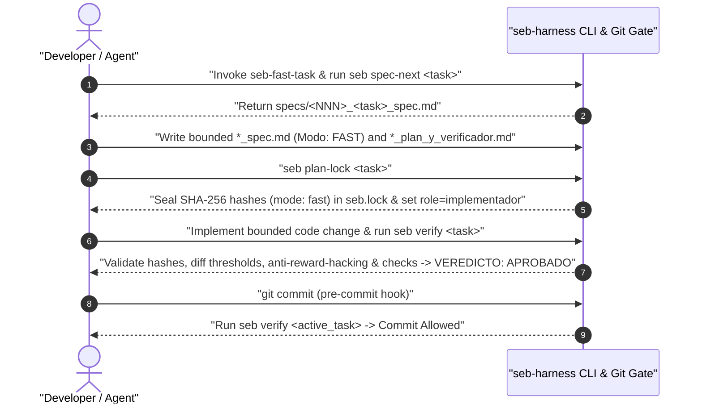
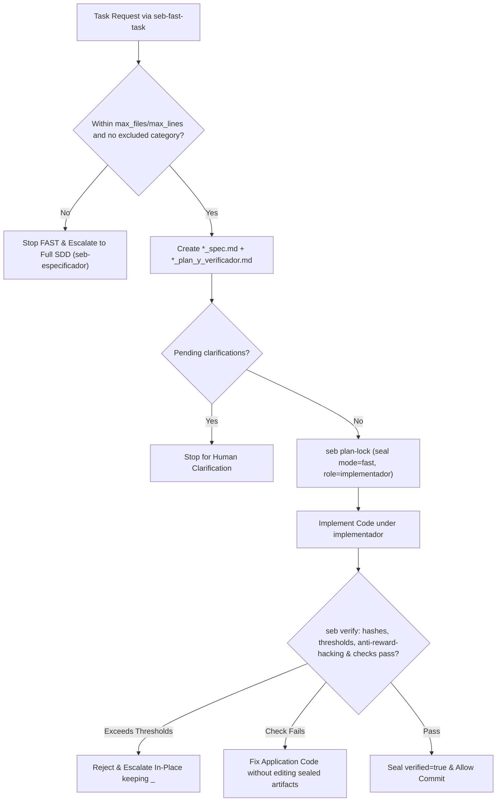

# UC-fast_task_lifecycle: Ciclo de Vida del Flujo Rapido (FAST) mediante Skill Dedicado

> **Trazabilidad SDD:** Derivado de la spec `specs/018_flujo_rapido_spec.md` (Requisitos: `018-RF-01`, `018-RF-04`, `018-RF-05`, `018-RF-06`, `018-RF-07`, `018-RF-08`, `018-RF-09`, `018-RF-10`, `018-RF-11`, `018-RF-12`, `018-RF-13`, `018-RNF-01`, `018-RNF-03`, `018-CL-01`, `018-CL-02`, `018-CL-03`, `018-CL-04`, `018-CL-05`, `018-CL-06`).

## 1. Ficha de Intencion
- **ID:** UC-fast_task_lifecycle
- **Actor Principal:** Desarrollador y Agente de IA operando explicitamente bajo el skill `seb-fast-task` (luego `implementador` y `seb-verificador`).
- **Disparador:** Invocacion explicita del skill `seb-fast-task` (`.agents/skills/seb-fast-task/SKILL.md`), enrutado desde `AGENTS.md`, seguido de `seb spec-next`, `seb plan-lock`, `seb verify` y `git commit` (`pre-commit`).
- **Precondiciones:**
  - El usuario invoca explicitamente el skill `seb-fast-task` (nunca se activa de forma implicita, `018-RF-05`).
  - La tarea cumple los criterios de elegibilidad: cambio menor y de bajo riesgo dentro de los umbrales vigentes (`<= 4` archivos modificados y `<= 100` lineas cambiadas por defecto, configurables en `.seb/config.json` bajo `fast_track`), sin cambios de arquitectura, nuevas dependencias, contratos publicos, esquemas de datos, reglas de negocio criticas ni nuevos casos de uso externos (`018-RF-06`).
- **Invariantes de Negocio:**
  - La guia operativa del flujo rapido vive exclusivamente en `.agents/skills/seb-fast-task/SKILL.md` sin duplicar un archivo `.agents/SEB-FAST.md` (`018-RF-01`).
  - El flujo genera exactamente dos artefactos Markdown acotados compartiendo numeracion secuencial `<NNN>`: `specs/<NNN>_<tarea>_spec.md` (`Modo: FAST`) y `specs/<NNN>_<tarea>_plan_y_verificador.md` (`018-RF-07`, `018-RNF-01`).
  - Separacion estricta generador/evaluador: `seb-fast-task` solo genera y sella los dos artefactos; tras `seb plan-lock`, el rol transiciona a `implementador`, que tiene prohibido editar ambos archivos sellados (`018-RF-09`, `018-RF-10`, `018-RF-12`).
  - `seb verify` y el hook `pre-commit` validan deterministamente hashes SHA-256, umbrales `fast_track`, ausencia de omisiones de tests (anti-reward-hacking) y todos los controles `<NNN>-CHK-XX` operando 100% offline y en clones limpios sin SQLite (`018-RF-11`, `018-RF-13`, `018-RNF-03`, `018-CL-06`).

## 2. Diagrama de Interaccion del Sistema (SSD)

## 3. Arbol de Decisiones (Elegibilidad y Escalamiento en Caliente)

## 4. Caminos Alternativos y Catalogo de Errores

| Error Code | Causa Raiz | Respuesta / Efecto |
| :--- | :--- | :--- |
| `FAST_THRESHOLD_EXCEEDED` | Diff de codigo supera `max_files` o `max_lines` configurados (default `4`/`100`) (`018-RF-08`, `018-CL-01`) | `seb verify` y `pre-commit` fallan con exit code `1` e instruyen escalar en caliente a SDD conservando `<NNN>_<tarea>` |
| `MIXED_ARTIFACTS_AMBIGUITY` | Coexisten `*_plan_y_verificador.md` y `*_plan.md`/`*_verificador.md` para el mismo `<NNN>` (`018-CL-02`) | `seb plan-lock`, `seb verify` y `seb status` rechazan la ambiguedad con exit code `1` |
| `INVALID_FAST_CONFIG` | `.seb/config.json` define `fast_track.max_files` o `max_lines` no numericos o `<= 0` (`018-CL-05`) | Rechazo inmediato con exit code `1` y diagnostico en `stderr` |
| `FAST_SPEC_NOT_APPROVED` | Spec acotada con etiquetas de aclaracion pendientes o `Estado` distinto de `APROBADA` (`018-RF-10`) | `seb plan-lock` bloquea el sellado con exit code `1` |
| `ANTI_REWARD_HACKING_VIOLATION` | Manipulacion de `*_spec.md`/`*_plan_y_verificador.md` sellados o insercion de `t.Skip`/`@Ignore`/`.skip`/`.only` en tests (`018-RF-12`) | `seb guard`, `PreToolUse` o `seb verify` deniegan la operacion con exit code `1` |

## 5. Postcondiciones y Efectos Secundarios
- **Estado Persistido:** `.seb/seb.lock` almacena `spec_hash`, `verifier_hash`, `mode: "fast"`, `verified: true` y `commit_hash`; `.seb/ACTIVE_TASK` y `.seb/ACTIVE_ROLE` se limpian tras verificar.
- **Documentacion UC:** Si la spec acotada declara en `Afecta-UC:` un `UC-*` existente, queda habilitada su actualizacion posterior mediante `seb-documentador` (`018-CL-03`).
- **Auditoria:** Registro en `.seb/seb-audit.db` (`tasks.mode = 'FAST'`, `agent_actions` y `verifications`), visible de forma diferenciada en `seb audit report` y `seb status`.
