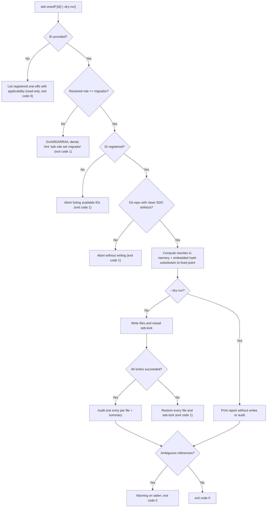

# UC-harness_oneoff_migration: Operaciones One-Off de Actualizacion del Arnes y Migracion de Identificadores

> **Trazabilidad SDD:** Derivado de la spec `specs/013_identificadores_unicos_requisitos_spec.md` (Requisitos: `013-RF-15` a `013-RF-30`, `013-RF-33`, `013-RNF-01`, `013-RNF-02`, `013-CL-04` a `013-CL-07`).

## 1. Ficha de Intencion
- **ID:** UC-harness_oneoff_migration
- **Actor Principal:** `Developer` (humano, desde su terminal) con el rol `migrador` activo
- **Disparador:** Invocacion de `seb oneoff` (listado), `seb oneoff <id_spec> [--dry-run]` (ejecucion) o actualizacion del arnes con `install.sh` en un proyecto con identificadores heredados.
- **Precondiciones:**
  - Para ejecutar: rol activo `migrador` (`seb role set migrador` o `SEB_SKILL=migrador`), resuelto con la precedencia `SEB_SKILL` > `.seb/ACTIVE_ROLE` > `implementador` (`resolveCLIRole`).
  - Repositorio Git sin cambios pendientes en `specs/`, `docs/use-cases/`, `MEMORY.md` y `.seb/seb.lock` (`gitPreconditionCheck`).
- **Invariantes de Negocio:**
  - Las operaciones one-off son excepcionales, se identifican por el ID de la spec que las define (`oneOffRegistry`) y constituyen la unica excepcion autorizada a la inmutabilidad de specs y verificadores sellados (`013-RF-15`, `013-RF-33`).
  - El listado sin ID es de solo lectura, se permite a cualquier rol e informa por cada operacion si es `APLICABLE` o `NO APLICABLE` al proyecto (`013-RF-16`).
  - La operacion `013` reescribe identificadores heredados (`HU`, `RF`, `RNF`, `CL`, `CHK`) anteponiendo el ID de la spec propietaria segun una regla de pertenencia determinista; nunca asigna un prefijo por inferencia a una referencia ambigua (`013-RF-20`, `013-RF-22`):
    - Artefactos de tarea (spec, plan, verificador): el identificador pertenece a la tarea del archivo, salvo que la misma linea mencione otra spec existente.
    - Artefactos documentales (`docs/use-cases/*.md`, `MEMORY.md`): el identificador se prefija solo si la linea menciona exactamente una spec existente.
    - Specs que ya declaran identificadores prefijados no se reescriben, y los bloques de codigo cercados se ignoran (`013-CL-03`, `013-CL-06`).
  - En los verificadores solo se reescriben las columnas `Check ID` y `Requisito`; descripcion y comando se preservan byte a byte, salvo la sustitucion de hashes sellados previos embebidos en comandos por sus hashes nuevos (`013-RF-21`, `013-RF-27`).
  - El resellado en `.seb/seb.lock` actualiza solo los hashes previamente sellados y preserva `verified`, `commit_hash`, `aborted` y las dependencias; no ejecuta los verificadores (`013-RF-23`).
  - La operacion es atomica e idempotente: ante un fallo restaura todos los archivos y `seb.lock`, y una segunda ejecucion termina sin cambios (`013-RF-29`, `013-RNF-01`).

## 2. Diagrama de Interaccion del Sistema (SSD)
```mermaid
sequenceDiagram
    autonumber
    actor Developer as "Developer (terminal)"
    participant System as "SebEngineCLI"

    Developer->>System: "seb oneoff"
    System-->>Developer: "OneOffList(013 APLICABLE: N legacy verifiers)"
    Developer->>System: "seb role set migrador"
    System-->>Developer: "RoleSetConfirmation(migrador)"
    Developer->>System: "seb oneoff 013 --dry-run"
    System-->>Developer: "MigrationReport(changes, rewritten IDs, hash substitutions, ambiguous refs; no writes)"
    Developer->>System: "seb oneoff 013"
    System-->>Developer: "MigrationReport(files rewritten, seb.lock resealed, audit recorded)"
    Developer->>System: "seb role clear"
    System-->>Developer: "RoleClearedConfirmation(implementador)"
```

## 3. Arbol de Decisiones


## 4. Caminos Alternativos y Catalogo de Errores
| Error Code | Causa Raiz | Respuesta / Efecto |
| :--- | :--- | :--- |
| `ONEOFF_ROLE_DENIED` | Ejecucion con un rol distinto de `migrador`, incluido el `implementador` por defecto | `GUARDARRAÍL DE MENOR PRIVILEGIO` en `stderr`, indicacion de `seb role set migrador` y `exit code 1` (`013-RF-17`) |
| `ONEOFF_NOT_REGISTERED` | ID sin operacion registrada | Aborto con `exit code 1` y listado de IDs disponibles (`013-RF-18`) |
| `GIT_PRECONDITION_FAILED` | Cambios sin commitear en artefactos a migrar o directorio fuera de un repositorio Git | Aborto con `exit code 1` sin modificar ningun archivo (`013-RF-28`) |
| `WRITE_FAILURE_ROLLBACK` | Fallo de escritura despues de comenzar a escribir | Restauracion de todos los archivos y de `seb.lock`, `exit code 1` (`013-RF-29`) |
| `AMBIGUOUS_REFERENCES` | Referencias heredadas cuya spec propietaria no es determinable | Se reportan con archivo, linea y texto; `exit code 0` con advertencia en `stderr` (`013-RF-22`, `013-RF-25`) |
| `LEGACY_PROJECT_AFTER_UPGRADE` | El arnes se actualizo en un proyecto heredado sin migrar | `install.sh` informa la cantidad de tareas heredadas y los comandos de migracion; `seb verify`, `seb plan-lock` y el hook `pre-commit` fallan hasta migrar (`013-RF-30`, `013-CL-07`) |
| `ALREADY_MIGRATED` | Proyecto sin specs o integramente prefijado | Termina con `exit code 0` sin modificaciones (`013-CL-04`, `013-RNF-01`) |

## 5. Postcondiciones y Efectos Secundarios
- **Estado Persistido:** Artefactos de tarea y documentales reescritos con identificadores prefijados y `.seb/seb.lock` con hashes resellados (`verified`, `commit_hash` y `aborted` intactos). Las referencias ambiguas que quedan en specs y planes sellados no deben editarse a mano, porque romperian el sello; solo pueden corregirse en `MEMORY.md` y `docs/use-cases/`.
- **Eventos Emitidos:** Ninguno.
- **Auditoria:** Una entrada `oneoff-013:rewrite` por archivo modificado (skill `migrador`, hash previo y nuevo) y una entrada `oneoff-013:summary` en `agent_actions` de `.seb/seb-audit.db`; las denegaciones se registran como `guard-blocked:oneoff` (`013-RF-24`).
