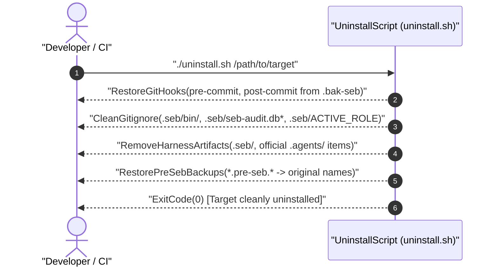
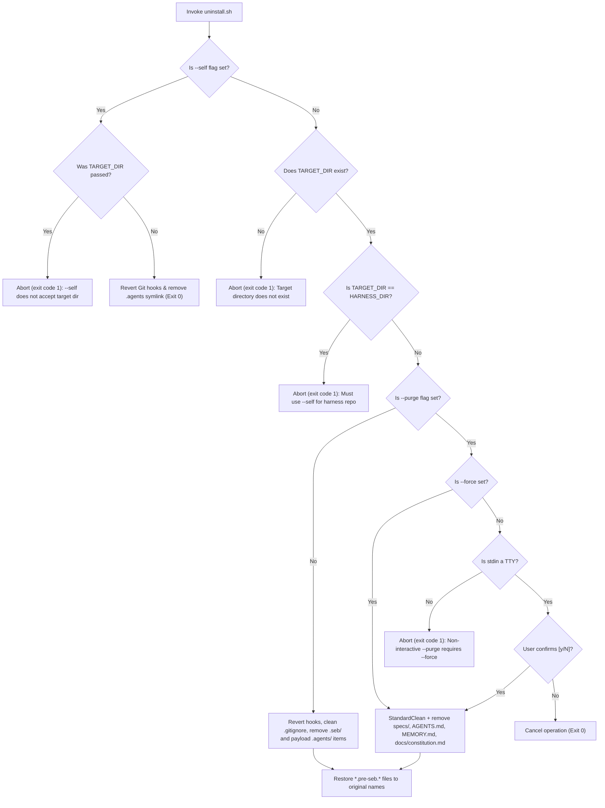

# UC-provisioning_harness_uninstall: Desinstalacion Quirurgica y Reversion del Arnes

> **Trazabilidad SDD:** Derivado de la spec `specs/003_desinstalacion_arnes_spec.md` (Requisitos: `003-RF-01` a `003-RF-18`, `003-RNF-01`, `003-RNF-02`). Complementado por `specs/007_migracion_contexto_brownfield_spec.md` (`007-RF-08`) y `specs/010_integracion_documentador_spec.md` (`010-RF-12`).
> **Revision (Spec 017):** `specs/017_separacion_protocolo_agents_spec.md` (Requisitos: `017-RF-10`, `017-RNF-03`, `017-CL-01`, `017-CL-02`, `017-CL-05`) incorpora la eliminacion de `.agents/SEB-HARNESS.md` y la remocion quirurgica del bloque gestionado `<!-- BEGIN/END seb-harness:managed -->` dentro de `AGENTS.md` en desinstalacion estandar (sin `--purge`).
> **Revision (Spec 018):** `specs/018_flujo_rapido_spec.md` (Requisitos: `018-RF-03`) garantiza la eliminacion de `.agents/skills/seb-fast-task/` y sus plantillas acotadas junto con los demas artefactos oficiales dentro de `.agents/` durante la desinstalacion estandar (respetando `--dry-run`).

## 1. Ficha de Intencion
- **ID:** UC-provisioning_harness_uninstall
- **Actor Principal:** `Developer`, `CIPipeline`
- **Disparador:** Ejecucion del script `./uninstall.sh [--self] [--dry-run] [--purge] [-f|--force] [-h|--help] [TARGET_DIR]`.
- **Precondiciones:**
  - Directorio objetivo existente en el sistema de archivos.
  - Presencia del directorio maestro `payload/.agents/` en el repositorio del arnes para identificar los componentes oficiales a desinstalar.
- **Invariantes de Negocio:**
  - Por defecto (sin `--purge`), se preservan intactos `specs/`, `docs/constitution.md`, `docs/use-cases/`, `MEMORY.md` y todo el contenido propio del proyecto en `AGENTS.md` fuera del bloque gestionado (`003-RF-17`, `010-RF-12`, `017-RF-10`).
  - Al desinstalar sin `--purge`, si `AGENTS.md` contiene un bloque gestionado valido, se remueve unicamente dicho bloque (eliminando `AGENTS.md` solo si no queda contenido propio del proyecto; respetando `--dry-run`) (`017-RF-10`, `017-CL-05`).
  - Dentro de `.agents/`, solo se eliminan los archivos y subdirectorios provistos por `payload/.agents/` (incluido `.agents/SEB-HARNESS.md`), conservando reglas o skills propios del proyecto (`003-RF-06`, `017-RF-10`).
  - En entornos no interactivos (`stdin` no es TTY), el uso de `--purge` exige obligatoriamente `--force` (`-f`) o aborta con codigo `1` (`003-RF-15`).

## 2. Diagrama de Interaccion del Sistema (SSD)

## 3. Arbol de Decisiones

## 4. Caminos Alternativos y Catalogo de Errores
| Error Code | Causa Raiz | Respuesta / Efecto |
| :--- | :--- | :--- |
| `SELF_WITH_TARGET_ARG` | Uso combinado de `--self` y un directorio destino posicional | Mensaje de error en `stderr` y salida con `exit code 1` (`003-RF-09`) |
| `MISSING_SELF_FLAG_ON_HARNESS` | Ejecucion sobre el propio repositorio `seb-harness` sin `--self` | Advertencia de seguridad en `stderr` y salida con `exit code 1` (`003-RF-10`) |
| `TARGET_DIR_NOT_FOUND` | El directorio objetivo especificado no existe | Mensaje de error en `stderr` y salida con `exit code 1` (`003-RF-11`) |
| `UNEXPECTED_AGENTS_SYMLINK` | `.agents` es un enlace simbolico en un proyecto destino sin `--self` | Aborto inmediato con `exit code 1` sin seguir ni borrar el enlace (`003-CL-04`) |
| `NON_INTERACTIVE_PURGE_WITHOUT_FORCE` | Invocacion de `--purge` sin TTY y sin `-f`/`--force` | Aborto inmediato con `exit code 1` protegiendo artefactos (`003-RF-15`, `003-CL-05`) |
| `MALFORMED_MANAGED_MARKERS_ON_UNINSTALL` | `AGENTS.md` presenta marcadores `BEGIN`/`END` malformados o duplicados durante desinstalacion sin `--purge` | Advertencia en `stderr` preservando intacto `AGENTS.md` sin abortar el resto de la desinstalacion (`017-CL-02`) |

## 5. Postcondiciones y Efectos Secundarios
- **Estado Persistido:** Eliminacion de `.seb/`, limpieza de entradas del arnes en `.gitignore`, remocion selectiva de `.agents/` (conservando archivos personalizados), restauracion de hooks `.bak-seb` y restauracion de respaldos `*.pre-seb.*`. Si se ejecuto `--purge`, eliminacion adicional de `specs/`, `AGENTS.md`, `MEMORY.md` y `docs/constitution.md` (removiendo `docs/` solo si queda vacio).
- **Eventos Emitidos:** Salida estandar informativa o simulada bajo `--dry-run`.
- **Auditoria:** No aplica (el directorio `.seb/` y su base SQLite local son removidos durante la operacion).
