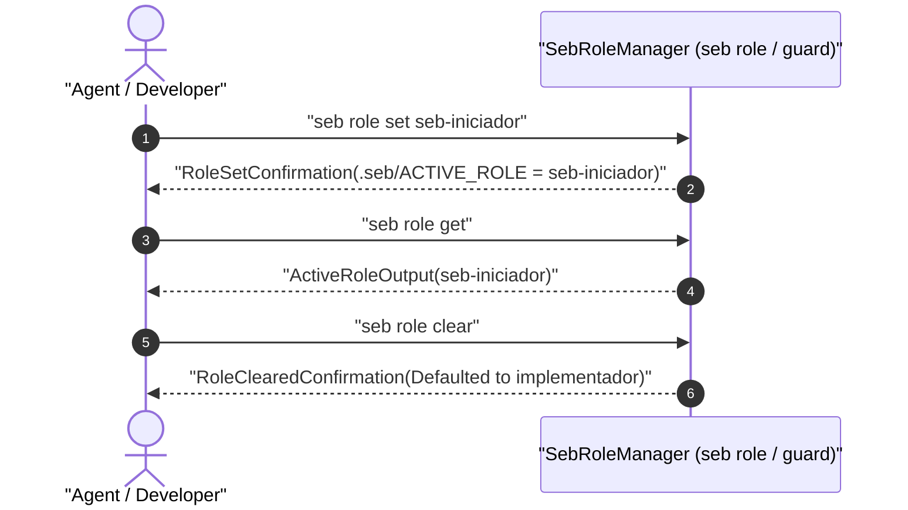
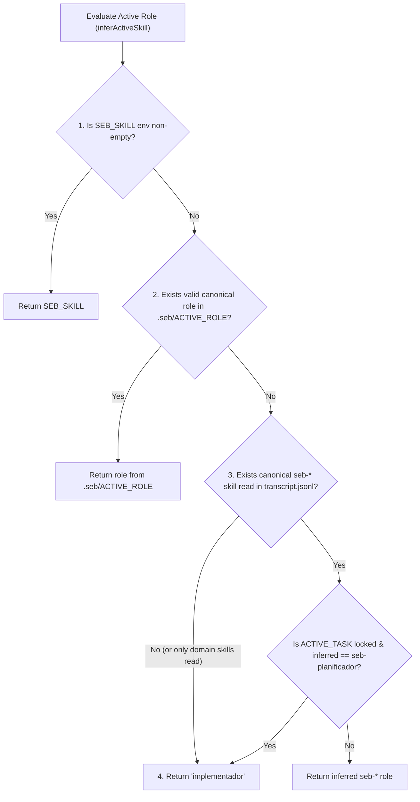
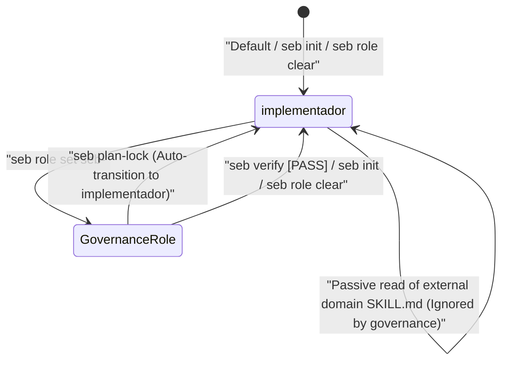

# UC-session_role_management: Gestion Determinista de Roles de Sesion y Aislamiento de Habilidades

> **Trazabilidad SDD:** Derivado de la spec `specs/008_estado_sesion_determinista_spec.md` (Requisitos: `RF-01` a `RF-09`, `RNF-01`, `RNF-02`).

## 1. Ficha de Intencion
- **ID:** UC-session_role_management
- **Actor Principal:** `Developer`, `AIAgent`, `HookInterceptor`
- **Disparador:** Invocacion de `seb role <set <role>|get|clear>`, transiciones de ciclo de vida (`seb plan-lock`, `seb verify`, `seb init`) o evaluacion de permisos en `seb guard` / `seb hook pre-tool`.
- **Precondiciones:**
  - Directorio `.seb/` inicializado o accesible en el espacio de trabajo local.
- **Invariantes de Negocio:**
  - Los roles canonicos de gobernanza conforman un conjunto cerrado: `seb-iniciador`, `seb-especificador`, `seb-clarificador`, `seb-planificador`, `seb-verificador`, `seb-documentador` e `implementador` (`canonicalRoles`).
  - La resolucion del rol activo (`inferActiveSkill`) aplica una jerarquia estricta de 4 niveles: 1) variable de entorno `SEB_SKILL`, 2) archivo local `.seb/ACTIVE_ROLE`, 3) ultima habilidad canonica `seb-*` leida en `transcript.jsonl`, 4) fallback a `implementador` (`RF-05`, `RF-06`).
  - La lectura pasiva de habilidades de soporte o dominio ajenas al prefijo `seb-` jamas muta el rol de gobernanza ni bloquea permisos de implementacion (`RF-06`, `RF-07`).

## 2. Diagrama de Interaccion del Sistema (SSD)

## 3. Arbol de Decisiones y Ciclo de Vida de Rol

## 4. Caminos Alternativos y Catalogo de Errores
| Error Code | Causa Raiz | Respuesta / Efecto |
| :--- | :--- | :--- |
| `INVALID_CANONICAL_ROLE` | Invocacion de `seb role set <rol>` con un nombre vacio o no perteneciente a `canonicalRoles` | Rechazo con `exit code 1`, listado de roles validos en `stderr` y conservacion del rol previo (`RF-02`) |
| `UNKNOWN_ROLE_SUBCOMMAND` | Subcomando distinto de `set`, `get` o `clear` | Mensaje de uso en `stderr` y `exit code 1` |
| `CORRUPT_OR_MISSING_ROLE_FILE` | Archivo `.seb/ACTIVE_ROLE` inexistente, vacio o con contenido invalido al consultar `get` | Retorno seguro del rol por defecto `implementador` con `exit code 0` (`CL-02`) |
| `PROTECTED_CONTRACT_WRITE_DENIED` | Rol `implementador` o habilidad de dominio intenta editar `docs/constitution.md`, `*_spec.md` o `*_verificador.md` | Denegacion inmediata en `checkPermission` con `exit code 1` (`RF-07`, `RF-08`) |

## 5. Postcondiciones y Efectos Secundarios
- **Estado Persistido:** Escritura o eliminacion del archivo local `.seb/ACTIVE_ROLE` (excluido de Git en `.gitignore`). Al ejecutar `seb plan-lock`, `.seb/ACTIVE_ROLE` se fija atomicamente en `implementador` (`RF-09`); al completar `seb verify` o `seb init`, se limpia automaticamente (`CL-04`).
- **Eventos Emitidos:** Ninguno.
- **Auditoria:** Las acciones interceptadas registran el rol resuelto en la columna `skill` de `agent_actions`.
