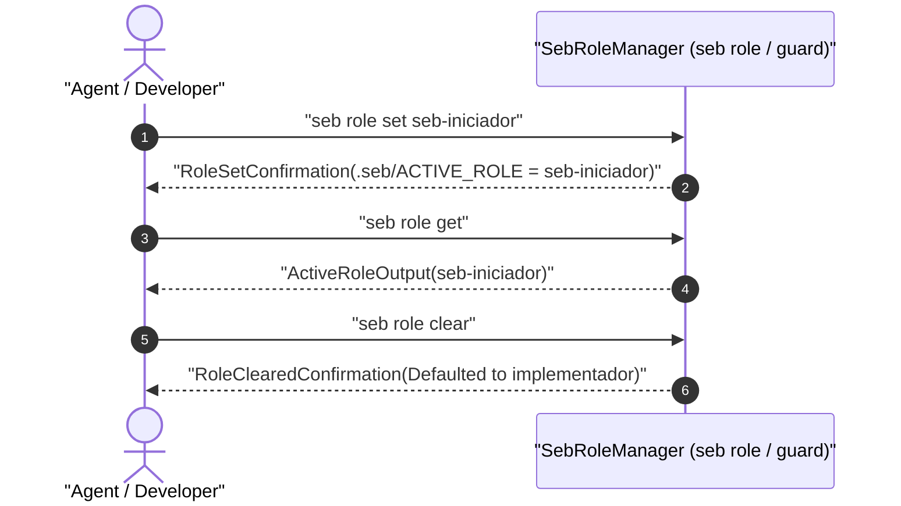
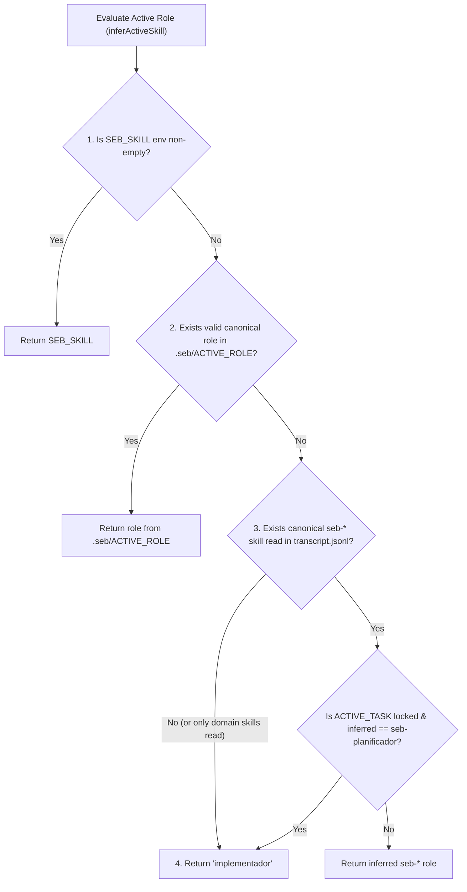
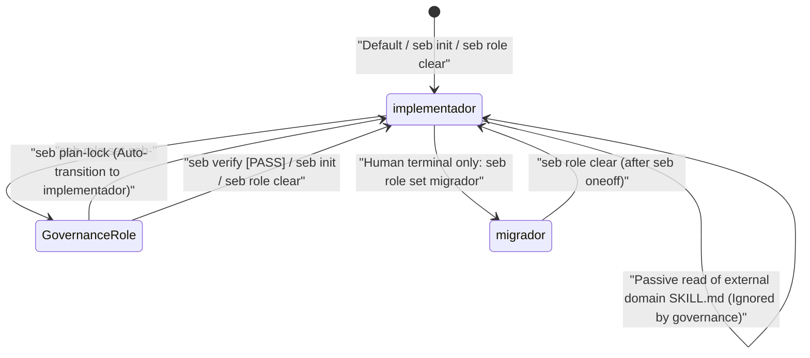

# UC-session_role_management: Gestion Determinista de Roles de Sesion y Aislamiento de Habilidades

> **Trazabilidad SDD:** Derivado de la spec `specs/008_estado_sesion_determinista_spec.md` (Requisitos: `008-RF-01` a `008-RF-09`, `008-RNF-01`, `008-RNF-02`).
> **Revision (Spec 013):** `specs/013_identificadores_unicos_requisitos_spec.md` (Requisitos: `013-RF-14`, `013-RF-17`, `013-RF-19`, `013-RF-33`) incorpora el rol one-off `migrador`, unico autorizado a ejecutar operaciones one-off, con politica de escritura propia y denegacion de escalada para agentes en `PreToolUse`.
> **Revision (Spec 018):** `specs/018_flujo_rapido_spec.md` (Requisitos: `018-RF-09`, `018-RF-12`, `018-RNF-03`) incorpora el rol canonico `seb-fast-task` (escritura restringida a `specs/*_spec.md`, `specs/*_plan_y_verificador.md` y `MEMORY.md`), bloquea la escritura sobre `specs/*_plan_y_verificador.md` para `implementador` y roles externos (tanto en `seb guard` como en `PreToolUse`) y transiciona automaticamente a `implementador` tras `seb plan-lock`.

## 1. Ficha de Intencion
- **ID:** UC-session_role_management
- **Actor Principal:** `Developer`, `AIAgent`, `HookInterceptor`
- **Disparador:** Invocacion de `seb role <set <role>|get|clear>`, transiciones de ciclo de vida (`seb plan-lock`, `seb verify`, `seb init`) o evaluacion de permisos en `seb guard` / `seb hook pre-tool`.
- **Precondiciones:**
  - Directorio `.seb/` inicializado o accesible en el espacio de trabajo local.
- **Invariantes de Negocio:**
  - Los roles canonicos de gobernanza conforman un conjunto cerrado: `seb-iniciador`, `seb-especificador`, `seb-clarificador`, `seb-planificador`, `seb-verificador`, `seb-documentador`, `implementador` y el rol one-off `migrador` (`canonicalRoles`; Spec 013 `013-RF-14`).
  - La resolucion del rol activo (`inferActiveSkill`) aplica una jerarquia estricta de 4 niveles: 1) variable de entorno `SEB_SKILL`, 2) archivo local `.seb/ACTIVE_ROLE`, 3) ultima habilidad canonica `seb-*` leida en `transcript.jsonl`, 4) fallback a `implementador` (`008-RF-05`, `008-RF-06`).
  - La lectura pasiva de habilidades de soporte o dominio ajenas al prefijo `seb-` jamas muta el rol de gobernanza ni bloquea permisos de implementacion (`008-RF-06`, `008-RF-07`).
  - El rol `migrador` solo puede escribir en `specs/*_spec.md`, `specs/*_plan.md`, `specs/*_verificador.md`, `docs/use-cases/*`, `MEMORY.md` y `.seb/seb.lock`; nunca en codigo fuente, tests ni `docs/constitution.md` (`isMigradorWritableTarget`, `013-RF-19`).
  - Solo el humano activa `migrador` desde su terminal: el hook `PreToolUse` deniega a cualquier agente, sea cual sea su rol, los comandos `seb oneoff <id>`, `seb role set migrador` y la inyeccion `SEB_SKILL=migrador` (`migradorEscalationRegex`, `013-RF-17`, `013-RF-33`).

## 2. Diagrama de Interaccion del Sistema (SSD)

## 3. Arbol de Decisiones y Ciclo de Vida de Rol

## 4. Caminos Alternativos y Catalogo de Errores
| Error Code | Causa Raiz | Respuesta / Efecto |
| :--- | :--- | :--- |
| `INVALID_CANONICAL_ROLE` | Invocacion de `seb role set <rol>` con un nombre vacio o no perteneciente a `canonicalRoles` | Rechazo con `exit code 1`, listado de roles validos en `stderr` y conservacion del rol previo (`008-RF-02`) |
| `UNKNOWN_ROLE_SUBCOMMAND` | Subcomando distinto de `set`, `get` o `clear` | Mensaje de uso en `stderr` y `exit code 1` |
| `CORRUPT_OR_MISSING_ROLE_FILE` | Archivo `.seb/ACTIVE_ROLE` inexistente, vacio o con contenido invalido al consultar `get` | Retorno seguro del rol por defecto `implementador` con `exit code 0` (`008-CL-02`) |
| `PROTECTED_CONTRACT_WRITE_DENIED` | Rol `implementador` o habilidad de dominio intenta editar `docs/constitution.md`, `*_spec.md` o `*_verificador.md` | Denegacion inmediata en `checkPermission` con `exit code 1` (`008-RF-07`, `008-RF-08`) |

| `MIGRADOR_WRITE_DENIED` | El rol `migrador` intenta escribir en codigo fuente, tests o `docs/constitution.md` | Denegacion en `checkPermission` con `exit code 1` (`013-RF-19`) |
| `ESCALATION_DENIED` | Un agente intenta `seb oneoff <id>`, `seb role set migrador` o `SEB_SKILL=migrador` | Decision `deny` en `PreToolUse` con `[seb-harness ANTI-ESCALADA]` y registro `guard-blocked:escalation` (`013-RF-33`) |

## 5. Postcondiciones y Efectos Secundarios
- **Estado Persistido:** Escritura o eliminacion del archivo local `.seb/ACTIVE_ROLE` (excluido de Git en `.gitignore`). Al ejecutar `seb plan-lock`, `.seb/ACTIVE_ROLE` se fija atomicamente en `implementador` (`008-RF-09`); al completar `seb verify` o `seb init`, se limpia automaticamente (`008-CL-04`).
- **Eventos Emitidos:** Ninguno.
- **Auditoria:** Las acciones interceptadas registran el rol resuelto en la columna `skill` de `agent_actions`.
