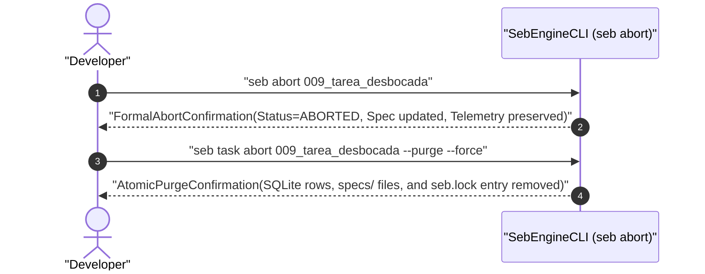
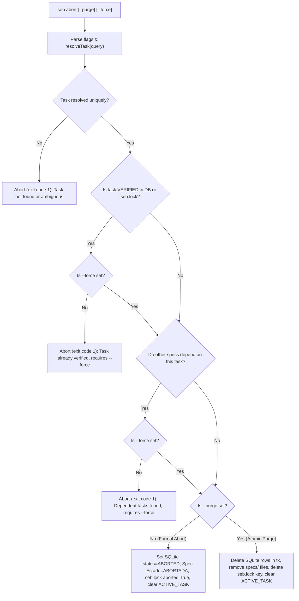
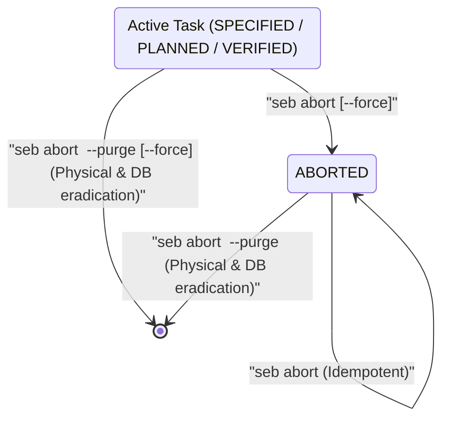

# UC-task_abort_and_purge: Aborto Formal y Purga Atomica de Tareas

> **Trazabilidad SDD:** Derivado de la spec `specs/009_aborto_tarea_spec.md` (Requisitos: `RF-01` a `RF-14`, `RNF-01`, `RNF-02`, `RNF-03`, `RNF-04`).

## 1. Ficha de Intencion
- **ID:** UC-task_abort_and_purge
- **Actor Principal:** `Developer`
- **Disparador:** Invocacion de `seb abort <task> [--purge] [--force|-f]` o su alias estructurado `seb task abort <task> [--purge] [--force|-f]`.
- **Precondiciones:**
  - La tarea objetivo debe existir en la base de datos local SQLite (`tasks`) o como especificacion fisica en `specs/<NNN>_<tarea>_spec.md`.
- **Invariantes de Negocio:**
  - Ninguna tarea formalmente verificada (`VERIFIED` o con `verified: true` y `commit_hash` en `.seb/seb.lock`) ni ninguna tarea de la cual dependan otras especificaciones en `specs/` puede ser abortada o purgada sin la bandera explicita `--force` (`-f`) (`RF-12`, `RF-13`).
  - El **Aborto Formal** (por defecto) conserva intactos los registros de telemetria y costos en `agent_actions`, actualiza el archivo spec a `Estado: ABORTADA` y marca `verified: false, aborted: true` en `.seb/seb.lock` (`RF-01`, `RF-02`, `RF-05`).
  - La **Purga Atomica** (`--purge`) elimina transaccionalmente los registros en SQLite (`verifications`, `agent_actions`, `tasks`), borra fisicamente la triada en `specs/` y remueve la clave de `.seb/seb.lock`, liberando el ID secuencial si era el mayor (`RF-06` a `RF-09`).

## 2. Diagrama de Interaccion del Sistema (SSD)

## 3. Arbol de Decisiones y Transiciones de Estado

## 4. Caminos Alternativos y Catalogo de Errores
| Error Code | Causa Raiz | Respuesta / Efecto |
| :--- | :--- | :--- |
| `TASK_NOT_FOUND` | El identificador suministrado no coincide con ninguna tarea | Mensaje `[seb-harness ERROR] tarea no encontrada` en `stderr` y `exit code 1` (`RF-10`) |
| `AMBIGUOUS_TASK_QUERY` | El nombre coincide con multiples tareas en distintas secuencias | Listado de candidatos en `stderr` y `exit code 1` (`RF-11`) |
| `SECURITY_BLOCK_VERIFIED_TASK` | Intento de abortar o purgar una tarea `VERIFIED` sin `--force` | Mensaje `BLOQUEO DE SEGURIDAD: La tarea '...' ya esta formalmente verificada` y `exit code 1` (`RF-13`) |
| `SECURITY_BLOCK_HAS_DEPENDENTS` | Otras especificaciones en `specs/` declaran depender de la tarea objetivo y no se paso `--force` | Mensaje `BLOQUEO DE SEGURIDAD: Las siguientes tareas dependen de '...'` y `exit code 1` (`RF-12`) |
| `UNKNOWN_ABORT_FLAG` | Bandera desconocida o multiples identificadores posicionales | Mensaje de error de sintaxis en `stderr` y `exit code 1` |

## 5. Postcondiciones y Efectos Secundarios
- **Estado Persistido:**
  - En modo por defecto: fila en `tasks` con `status = 'ABORTED'`, cabecera `- **Estado:** \`ABORTADA\`` en `specs/<NNN>_<tarea>_spec.md`, entrada en `.seb/seb.lock` con `"verified": false, "aborted": true` y limpieza de `.seb/ACTIVE_TASK` si coincidia.
  - En modo `--purge`: eliminacion transaccional en `verifications`, `agent_actions` y `tasks`, eliminacion fisica de `_spec.md`, `_plan.md` y `_verificador.md`, eliminacion de la clave en `.seb/seb.lock` y limpieza de `.seb/ACTIVE_TASK`.
- **Eventos Emitidos:** Confirmacion en salida estandar.
- **Auditoria:** En aborto formal se retiene toda la telemetria historica; en purga se elimina todo rastro de la tarea.
