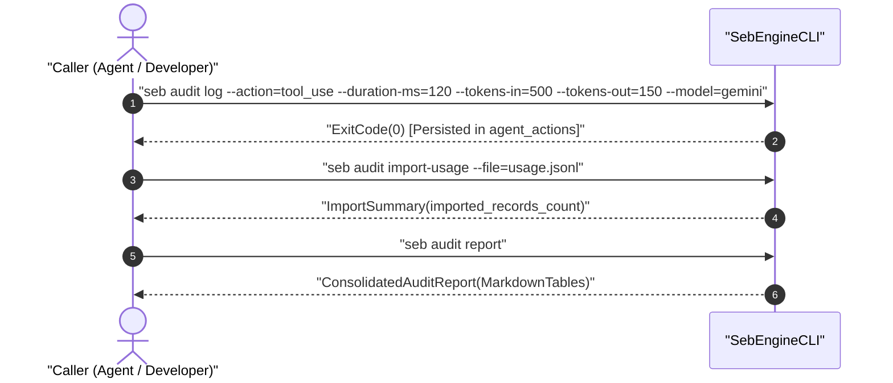
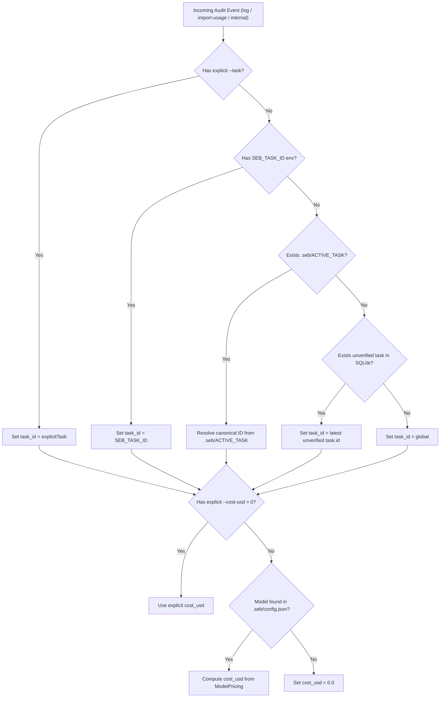

# UC-telemetry_action_logging: Registro de Telemetria, Duracion y Tokens de Acciones

> **Trazabilidad SDD:** Derivado de la spec `specs/001_registro_telemetria_acciones_spec.md` (Requisitos: `RF-01`, `RF-02`, `RF-03`, `RF-04`, `RF-05`, `RF-06`, `RF-07`, `RF-08`, `RF-09`, `RNF-01`, `RNF-02`, `RNF-03`).

## 1. Ficha de Intencion
- **ID:** UC-telemetry_action_logging
- **Actor Principal:** `Developer`, `AIAgent`, `GitHookProcess`
- **Disparador:** Invocacion de los comandos CLI `seb audit log`, `seb audit import-usage`, `seb audit report` o ejecucion de subcomandos internos (`spec-next`, `plan-lock`, `verify`, `memory-add`, `guard`).
- **Precondiciones:**
  - Base de datos local `.seb/seb-audit.db` accesible o inicializable mediante esquema `agent_actions`.
  - Archivo opcional `.seb/config.json` con estructura `EngineConfig` y tarifas `ModelPricing` (`prompt_price_per_million`, `completion_price_per_million`) para calculo de costos por modelo.
- **Invariantes de Negocio:**
  - Toda duracion negativa producto de desfase de reloj es normalizada a `0` milisegundos (`normalizeDuration`).
  - La asociacion de tarea sigue estrictamente la cascada determinista (`resolveActiveTask`): parametro explicito `--task`, variable de entorno `SEB_TASK_ID`, archivo `.seb/ACTIVE_TASK`, ultima tarea no verificada en `tasks`, o fallback `global`.
  - La importacion de registros desde `usage.jsonl` (`UsageRecord`) es idempotente respecto a la tupla `(task_id, parameters, timestamp)`.

## 2. Diagrama de Interaccion del Sistema (SSD)

## 3. Arbol de Decisiones

## 4. Caminos Alternativos y Catalogo de Errores
| Error Code | Causa Raiz | Respuesta / Efecto |
| :--- | :--- | :--- |
| `NEGATIVE_DURATION_CLOCK_SKEW` | Medicion de tiempo arroja `duration_ms < 0` | Normalizacion silenciosa a `0` ms sin interrumpir la ejecucion (`RF-07`) |
| `MISSING_PRICING_CONFIG` | Archivo `.seb/config.json` inexistente o modelo no listado en `pricing` | Registro de la accion con `cost_usd = 0.0` preservando conteo de tokens (`RF-03`, `CL-04`) |
| `DUPLICATE_USAGE_RECORD` | Linea en `usage.jsonl` ya importada previamente con igual `task_id`, `turns` y `timestamp` | Omision idempotente del registro duplicado sin alterar sumatorias (`CL-05`) |
| `USAGE_FILE_NOT_FOUND` | Ruta suministrada a `seb audit import-usage` no existe | Salida inmediata con `[seb-harness ERROR]` en `stderr` y `exit code 1` |
| `UNKNOWN_AUDIT_SUBCOMMAND` | Subcomando distinto de `log`, `import-usage` o `report` | Mensaje de uso en `stderr` y `exit code 1` |

## 5. Postcondiciones y Efectos Secundarios
- **Estado Persistido:** Insercion de fila en la tabla local `agent_actions` de `.seb/seb-audit.db` incluyendo `session_id`, `task_id`, `agent`, `skill`, `action`, `parameters`, `result_summary`, `duration_ms`, `tokens_in`, `tokens_out`, `cost_usd` y `exit_code`.
- **Eventos Emitidos:** Ninguno externo (operacion estrictamente offline sobre SQLite WAL).
- **Auditoria:** Disponible de forma agregada por tarea y listado de ultimas 10 acciones mediante `seb audit report`.
