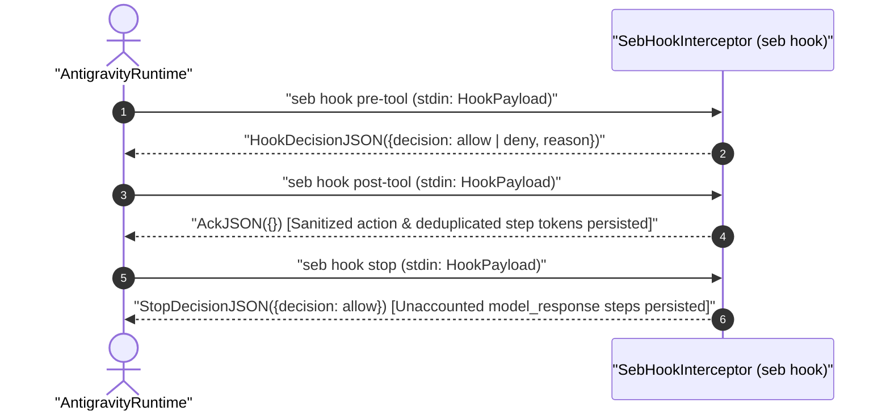
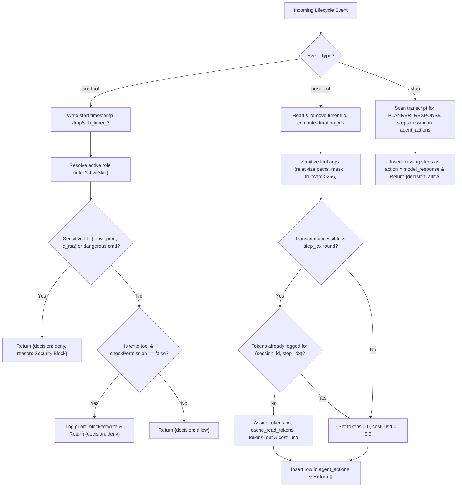

# UC-telemetry_antigravity_interception: Intercepcion de Ciclo de Vida, Tokens en Cache y Saneamiento en Antigravity

> **Trazabilidad SDD:** Derivado de la spec `specs/004_captura_telemetria_antigravity_spec.md` (Requisitos: `004-RF-01` a `004-RF-13`, `004-RNF-01`, `004-RNF-02`, `004-RNF-03`). Extiende el subsistema base de `specs/001_registro_telemetria_acciones_spec.md`.

## 1. Ficha de Intencion
- **ID:** UC-telemetry_antigravity_interception
- **Actor Principal:** `AntigravityRuntime` (Antigravity 2.0 Desktop / `agy` CLI)
- **Disparador:** Eventos de ciclo de vida `PreToolUse`, `PostToolUse` y `Stop` despachados via `.agents/hooks.json` hacia `seb hook <pre-tool|post-tool|stop>` con carga util JSON `HookPayload` en `stdin`.
- **Precondiciones:**
  - Archivo `.agents/hooks.json` y scripts interceptores aprovisionados en el espacio de trabajo.
  - Base de datos `.seb/seb-audit.db` con migracion automatica de columnas `cache_read_tokens` y `step_idx` (`migrateDBSchema`).
- **Invariantes de Negocio:**
  - Los tokens de un paso (`tokens_in`, `cache_read_tokens`, `tokens_out`) leidos desde `transcript.jsonl` (`TranscriptStep`) se imputan exclusivamente a la primera accion registrada de cada `(session_id, step_idx)`, asignando `0` a herramientas paralelas del mismo turno (`004-RF-04`, `004-CL-02`).
  - Los tokens leidos de cache (`cache_read_tokens`) se contabilizan en volumen pero se excluyen del calculo de `cost_usd` (`004-RF-05`).
  - Ningun parametro persistido contiene rutas absolutas del host: las rutas internas al workspace se relativizan, las externas se reemplazan por `<EXTERNAL_PATH>/<basename>` y las cadenas mayores a 256 caracteres se truncan con `...[TRUNCATED]` (`004-RF-06`, `004-RF-07`, `004-RNF-02`).

## 2. Diagrama de Interaccion del Sistema (SSD)

## 3. Arbol de Decisiones

## 4. Caminos Alternativos y Catalogo de Errores
| Error Code | Causa Raiz | Respuesta / Efecto |
| :--- | :--- | :--- |
| `SECURITY_SENSITIVE_FILE_DENIED` | Intento de acceso a `.env`, `.pem`, `.key`, `id_rsa` o `id_ed25519` en `pre-tool` | Retorno de `{"decision":"deny","reason":"[seb-harness BLOQUEO DE SEGURIDAD]..."}` |
| `SECURITY_DANGEROUS_CMD_DENIED` | Comando contiene `rm -rf /`, `git commit --no-verify`, `git push --force` o `chmod 777` | Retorno de `{"decision":"deny","reason":"[seb-harness BLOQUEO DE SEGURIDAD]..."}` |
| `ANTI_REWARD_HACKING_SHELL_DENIED` | Rol `implementador` intenta redirigir salida shell (`>`, `tee`, `sed -i`) hacia contratos SDD | Retorno de `{"decision":"deny","reason":"[seb-harness ANTI-REWARD-HACKING]..."}` |
| `LEAST_PRIVILEGE_WRITE_DENIED` | El rol activo carece de permisos de escritura sobre `targetPath` | Registro de `guard-blocked:write` en SQLite y retorno de `{"decision":"deny"}` (`004-RF-01`) |
| `TRANSCRIPT_UNAVAILABLE` | Archivo `transcriptPath` inexistente o ilegible durante `post-tool` | Registro de la accion con tokens en `0` sin interrumpir el flujo del agente (`004-RF-09`) |
| `TOOL_EXECUTION_ERROR` | Campo `error` no vacio en `HookPayload` durante `post-tool` | Registro de `exit_code = 1` y mensaje saneado en `result_summary` (`004-RF-08`) |

## 5. Postcondiciones y Efectos Secundarios
- **Estado Persistido:** Migracion idempotente de `agent_actions` (`cache_read_tokens`, `step_idx`), creacion y limpieza de archivo temporal `/tmp/seb_timer_<session>_<step>_<tool>`, e insercion de registros de herramientas y respuestas de texto (`model_response`) con parametros saneados.
- **Eventos Emitidos:** Respuesta JSON sincrona en `stdout` consumida por el motor de Antigravity.
- **Auditoria:** Columna `Cache Read` expuesta en `seb audit report`.
