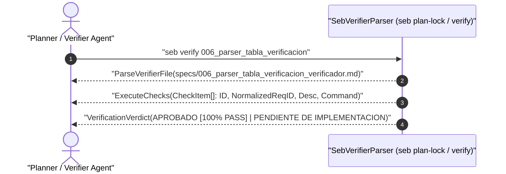
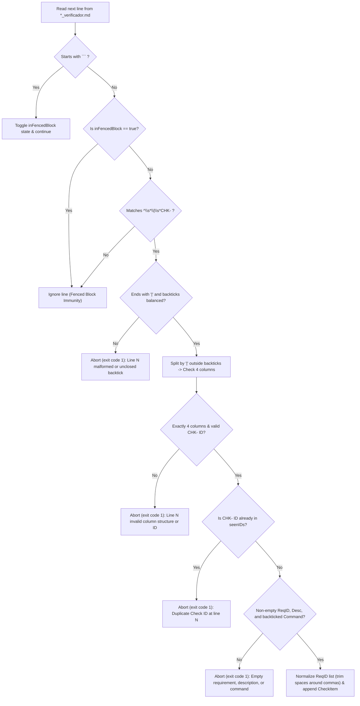

# UC-verifier_table_parsing: Analisis Sintactico Determinista de Matrices de Verificacion y Prevencion de Omisiones Silenciosas

> **Trazabilidad SDD:** Derivado de la spec `specs/006_parser_tabla_verificacion_spec.md` (Requisitos: `RF-01` a `RF-10`, `RNF-01`, `RNF-02`, `RNF-03`).

## 1. Ficha de Intencion
- **ID:** UC-verifier_table_parsing
- **Actor Principal:** `Developer`, `AIAgent` (`seb-planificador`, `seb-verificador`)
- **Disparador:** Invocacion de `seb plan-lock <task>` o `seb verify <task>` que dispara internamente `parseVerifierFile(task.VerifierPath)`.
- **Precondiciones:**
  - Archivo `specs/<NNN>_<tarea>_verificador.md` existente en disco.
- **Invariantes de Negocio:**
  - Cero omisiones silenciosas (*Anti-Silent-Drop*): toda linea fuera de bloques de codigo cercados que comience con `|` y el prefijo `CHK-` (`checkCandidateRegex`) debe cumplir estrictamente la estructura de 4 columnas (`Check ID`, `Requisito`, `Descripcion`, `Comando` entre backticks) o abortar la ejecucion con `exit code 1` (`RF-03`, `RF-05`).
  - Los operadores de shell (`|`, `||`, `&&`) dentro de comillas invertidas no fragmentan las celdas de la tabla Markdown (`RF-04`).
  - Los identificadores `CHK-XX` deben ser unicos en todo el archivo (`RF-06`) y las listas de requisitos heterogeneos (`RF-`, `RNF-`, `CL-`, `GLOBAL`) se normalizan eliminando espacios adyacentes a las comas (`RF-01`, `RF-02`).

## 2. Diagrama de Interaccion del Sistema (SSD)

## 3. Arbol de Decisiones

## 4. Caminos Alternativos y Catalogo de Errores
| Error Code | Causa Raiz | Respuesta / Efecto |
| :--- | :--- | :--- |
| `MALFORMED_CONTROL_ROW` | Fila `CHK-` sin pipe final `|` o con estructura distinta de 4 columnas | Aborto inmediato de `plan-lock` o `verify` indicando numero de linea y `exit code 1` (`RF-03`) |
| `UNCLOSED_BACKTICKS` | Comillas invertidas impares o comando sin delimitadores `` ` `` en la cuarta columna | Aborto inmediato indicando la linea afectada y `exit code 1` (`RF-05`, `CL-05`) |
| `DUPLICATE_CHECK_ID` | Dos filas declaran el mismo identificador `CHK-XX` | Aborto inmediato indicando la linea actual y la linea previa de declaracion (`RF-06`, `CL-04`) |
| `EMPTY_REQ_OR_COMMAND` | Celda de requisitos vacia, elemento vacio entre comas (`RF-01, `) o comando vacio `` `` `` | Aborto inmediato con diagnostico de linea y `exit code 1` (`RF-05`) |
| `NO_EXECUTABLE_CHECKS` | El archivo verificador no contiene ninguna fila `CHK-` valida | Aborto con mensaje `el archivo no contiene controles ejecutables validos` y `exit code 1` (`RF-08`, `CL-06`) |

## 5. Postcondiciones y Efectos Secundarios
- **Estado Persistido:** Insercion de resultados por cada `CheckItem` en la tabla `verifications` de `.seb/seb-audit.db` con `req_id` normalizado (ej. `RNF-01,RNF-02`).
- **Eventos Emitidos:** Ninguno.
- **Auditoria:** Registro de ejecucion de `verify` o `plan-lock` en `agent_actions`.
