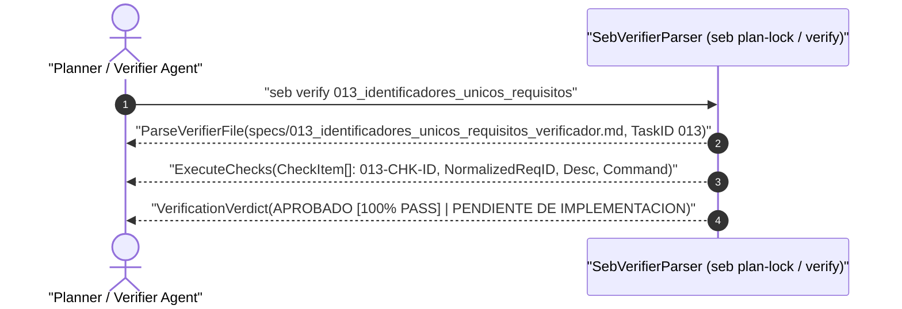
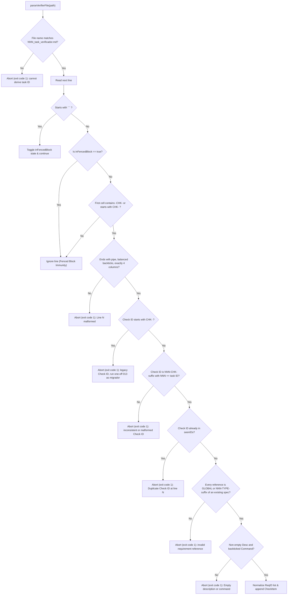

# UC-verifier_table_parsing: Analisis Sintactico Determinista de Matrices de Verificacion y Prevencion de Omisiones Silenciosas

> **Trazabilidad SDD:** Derivado de la spec `specs/006_parser_tabla_verificacion_spec.md` (Requisitos: `006-RF-01` a `006-RF-10`, `006-RNF-01`, `006-RNF-02`, `006-RNF-03`).
> **Revision (Spec 013):** `specs/013_identificadores_unicos_requisitos_spec.md` (Requisitos: `013-RF-07` a `013-RF-13`, `013-CL-01` a `013-CL-03`, `013-CL-07` a `013-CL-09`) convierte el formato prefijado `<NNN>-CHK-<sufijo>` en el unico valido, valida las referencias de requisito contra las specs existentes y rechaza el formato heredado `CHK-NN` indicando el comando de migracion.
> **Revision (Spec 018):** `specs/018_flujo_rapido_spec.md` (Requisitos: `018-RF-11`, `018-CL-04`) extiende `taskIDFromVerifierPath` y `parseVerifierFile` para soportar la matriz verificadora embebida en `specs/<NNN>_<tarea>_plan_y_verificador.md` con las mismas reglas de prefijos `<NNN>-CHK-*` y politica Anti-Silent-Drop.

## 1. Ficha de Intencion
- **ID:** UC-verifier_table_parsing
- **Actor Principal:** `Developer`, `AIAgent` (`seb-planificador`, `seb-verificador`)
- **Disparador:** Invocacion de `seb plan-lock <task>` o `seb verify <task>` que dispara internamente `parseVerifierFile(task.VerifierPath)`.
- **Precondiciones:**
  - Archivo `specs/<NNN>_<tarea>_verificador.md` existente en disco; el ID de tarea `<NNN>` se deriva del nombre del archivo (`taskIDFromVerifierPath`).
- **Invariantes de Negocio:**
  - Cero omisiones silenciosas (*Anti-Silent-Drop*): toda fila de tabla fuera de bloques de codigo cercados cuya primera celda contenga `-CHK-` o comience con `CHK-` (`isCandidateFirstCell`) es candidata a control y debe cumplir estrictamente la estructura de 4 columnas (`Check ID`, `Requisito`, `Descripcion`, `Comando` entre backticks) o abortar la ejecucion con `exit code 1` (`006-RF-03`, `006-RF-05`, `013-RF-07`).
  - El `Check ID` es valido solo si comienza con `<NNN>-CHK-`, donde `<NNN>` es el ID de la tarea verificada, seguido de un sufijo no vacio de letras, digitos, `_` o `-` (ej. `013-CHK-01`, `013-CHK-SMOKE`) (`validateCheckID`, `013-RF-08`, `013-CL-02`).
  - Cada referencia de la columna `Requisito` es `GLOBAL` o un identificador `<NNN>-<TIPO>-<sufijo>` con `<TIPO>` en `HU`, `RF`, `RNF`, `CL`, `CHK` y `<NNN>` correspondiente a una spec existente en disco en el directorio del verificador; se admiten referencias cruzadas a otras specs (ej. `005-RF-03` desde la `013`) (`validateRequirementRef`, `013-RF-11`, `013-CL-01`).
  - Los operadores de shell (`|`, `||`, `&&`) dentro de comillas invertidas no fragmentan las celdas de la tabla Markdown (`006-RF-04`).
  - Los `Check ID` son unicos en todo el archivo (`006-RF-06`) y las listas de requisitos se normalizan eliminando espacios adyacentes a las comas (`006-RF-01`, `006-RF-02`).
  - Las reglas son identicas en `seb plan-lock` y `seb verify` y no dependen de ningun numero de corte ni de configuracion por proyecto (`013-RF-13`).
  - Las menciones heredadas en specs o planes no bloquean la verificacion: el rechazo aplica solo a las filas de los verificadores (`013-CL-08`).

## 2. Diagrama de Interaccion del Sistema (SSD)

## 3. Arbol de Decisiones

## 4. Caminos Alternativos y Catalogo de Errores
| Error Code | Causa Raiz | Respuesta / Efecto |
| :--- | :--- | :--- |
| `UNDERIVABLE_TASK_ID` | El nombre del verificador no respeta `<NNN>_<tarea>_verificador.md` | Aborto inmediato con `exit code 1` |
| `MALFORMED_CONTROL_ROW` | Fila candidata sin pipe final `|` o con estructura distinta de 4 columnas | Aborto inmediato de `plan-lock` o `verify` indicando numero de linea y `exit code 1` (`006-RF-03`) |
| `UNCLOSED_BACKTICKS` | Comillas invertidas impares o comando sin delimitadores `` ` `` en la cuarta columna | Aborto inmediato indicando la linea afectada y `exit code 1` (`006-RF-05`, `006-CL-05`) |
| `LEGACY_CHECK_ID` | Fila con `Check ID` heredado `CHK-NN` | Aborto con `exit code 1`, linea, identificador y comando `.seb/bin/seb role set migrador && .seb/bin/seb oneoff 013` en `stderr` (`013-RF-09`, `013-CL-07`) |
| `INCONSISTENT_CHECK_ID` | Prefijo distinto al ID de la tarea verificada o malformado (ej. `012-CHK-01` en la `013`, `13-CHK-01`) | Aborto con `exit code 1` indicando linea e identificador (`013-RF-10`) |
| `INVALID_REQUIREMENT_REF` | Referencia heredada, tipo desconocido, prefijo malformado o spec inexistente (incluidas specs purgadas) | Aborto con `exit code 1` indicando linea y referencia (`013-RF-12`, `013-CL-09`) |
| `DUPLICATE_CHECK_ID` | Dos filas declaran el mismo `Check ID` | Aborto inmediato indicando la linea actual y la linea previa de declaracion (`006-RF-06`, `006-CL-04`) |
| `EMPTY_REQ_OR_COMMAND` | Celda de requisitos vacia, elemento vacio entre comas o comando vacio | Aborto inmediato con diagnostico de linea y `exit code 1` (`006-RF-05`) |
| `NO_EXECUTABLE_CHECKS` | El archivo verificador no contiene ninguna fila de control valida | Aborto con mensaje `el archivo no contiene controles ejecutables validos` y `exit code 1` (`006-RF-08`, `006-CL-06`) |

## 5. Postcondiciones y Efectos Secundarios
- **Estado Persistido:** Insercion de resultados por cada `CheckItem` en la tabla `verifications` de `.seb/seb-audit.db` con `check_id` prefijado y `req_id` normalizado (ej. `013-RF-07,013-CL-01`).
- **Eventos Emitidos:** Ninguno.
- **Auditoria:** Registro de ejecucion de `verify` o `plan-lock` en `agent_actions`.
